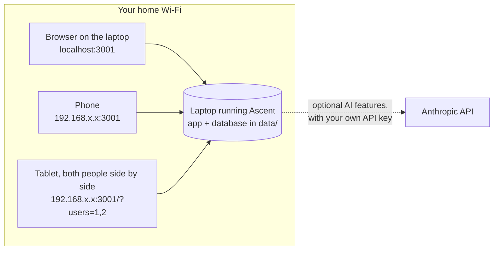
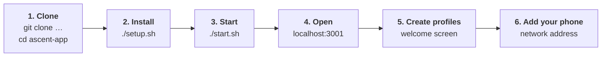
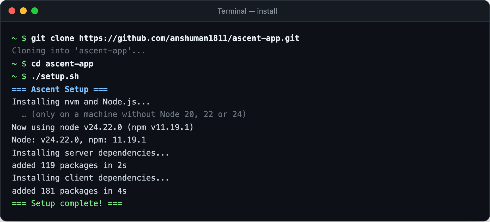
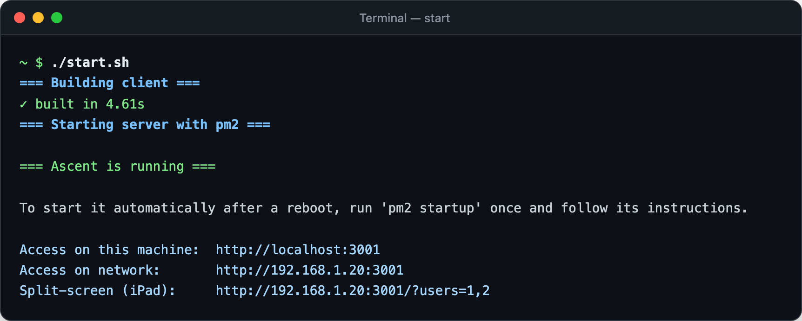
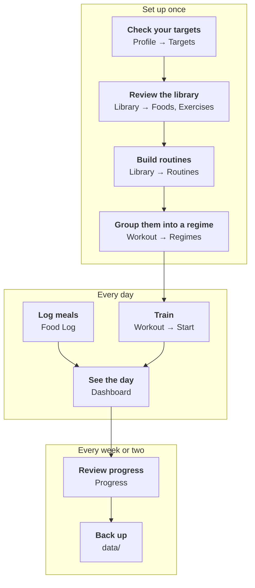

# Ascent

A local fitness and meal tracker for one or two people in a household. It runs entirely on your own machine — no account, no cloud, no subscription, and nothing leaves your home network.


| | |
|---|---|
| **[Getting started](docs/getting-started.md)** | Install it, create your profiles, open it on your phone — about five minutes |
| **[User guide](docs/guide.md)** | Set up your library, routines and regimes, then log workouts and meals |

## How it works

One laptop (or any always-on Mac or Linux machine) runs Ascent and keeps all the data. Everyone else in the house opens it in a browser on the same Wi-Fi — no app store, no account.



## Features

### Training
- **Live workout tracking** — start from a routine or ad-hoc; log sets, reps, weight or timed holds, with a rest timer that stays in sync across devices, a running calorie estimate, technique notes and a muscle map for each exercise
- **Routines and regimes** — build routines from the exercise library, then chain them into a regime (e.g. Upper / Lower) so the app knows which one is up next
- **Personal records** — one PR per exercise, flagged the moment you beat it
- **Progress** — muscle-volume heatmap, estimated 1-rep-max trends, and an optional AI summary of your training
- **Other activity** — log a walk, run or hike so it counts toward the day

### Nutrition
- **Food log** — meals by type with flexible portions, quick re-log from recent items, and optional AI parsing of a plain-English description ("two eggs and toast")
- **Food library** — 100 starter foods with full nutrition-label fields; add your own, including recipes built from ingredients
- **Daily dashboard** — calorie ring and macro bars against a target that adapts on workout days

### Household
- **One or two profiles** — independent logs, targets and routines; switch with one tap, or put both side by side on a tablet with split-screen
- **Auto-calculated targets** — calorie target from your stats and goal (Mifflin-St Jeor), with the macros you choose to track

---

## Quick Start



You need macOS or Linux, `git`, and [Node.js](https://nodejs.org) 20, 22 or 24 — if you don't have a supported Node, the setup script installs Node 24 through [nvm](https://github.com/nvm-sh/nvm).

```bash
git clone https://github.com/anshuman1811/ascent-app.git
cd ascent-app
./setup.sh     # installs dependencies
./start.sh     # builds the app and starts it in the background with pm2
```

What you'll see — first the install:



then the start script, which ends with the addresses to open:



Open **http://localhost:3001** and follow the welcome screen. Use the **network** address on your phone or tablet.

### After that



Each step is explained, with screenshots, in the **[user guide](docs/guide.md)**.

The full walkthrough, including optional extras (exercise demo GIFs, AI features, starting on login, backups), is in **[Getting started](docs/getting-started.md)**.

### Developing

```bash
cd server && npm run dev     # API on :3001, restarts on change
cd client && npm run dev     # UI on :5173 with hot reload, proxies /api to :3001
```

---

## Tech Stack

| Layer | Tech |
|---|---|
| Frontend | React 18, TypeScript, Vite, Tailwind CSS |
| State | TanStack Query v5 (server), Zustand (client) |
| Routing | React Router v6 (BrowserRouter + MemoryRouter for split-screen) |
| Backend | Node.js, Express (CommonJS) |
| Database | SQLite via `better-sqlite3` |
| Process mgmt | pm2 |
| Images | multer + uuid, stored in `data/uploads/` |
| Charts | Recharts |
| Icons | Lucide React |
| Muscle SVG | [vulovix/body-muscles](https://github.com/vulovix/body-muscles) (Apache 2.0) |

---

## Project Structure

```
ascent-app/
├── client/                    # React frontend
│   ├── src/
│   │   ├── api/               # Fetch client helpers
│   │   ├── components/
│   │   │   ├── MuscleMap/     # Anatomical SVG data (108 muscle regions)
│   │   │   └── ui/            # Shared UI components (Button, Modal, MuscleMap, etc.)
│   │   ├── pages/
│   │   │   ├── Dashboard.tsx  # Daily calorie/macro overview + weekly chart
│   │   │   ├── FoodLog.tsx    # Meal logging per day
│   │   │   ├── Library/       # Food, Exercise, Routine library tabs
│   │   │   ├── Workout/       # Start workout, history, personal bests
│   │   │   ├── Profile.tsx    # User targets (calories, macros, units)
│   │   │   └── Settings.tsx   # App-wide settings
│   │   ├── store/             # Zustand stores (active user, etc.)
│   │   └── types.ts           # Shared TypeScript types
│   └── vite.config.ts         # Proxy /api and /uploads → :3001
│
├── server/
│   ├── db/
│   │   └── index.js           # SQLite schema, migrations, exercise seed data
│   ├── routes/
│   │   ├── dashboard.js       # Daily summary, weekly chart
│   │   ├── exercises.js       # Exercise CRUD
│   │   ├── foods.js           # Food CRUD
│   │   ├── images.js          # Multi-image upload/delete per entity
│   │   ├── meals.js           # Meal logging + macro computation
│   │   ├── routines.js        # Routine + routine_exercise CRUD
│   │   ├── users.js           # User profiles
│   │   └── workouts.js        # Workout sessions + personal bests
│   └── index.js               # Express app entry point
│
├── data/                      # SQLite database + uploaded images (gitignored)
├── ecosystem.config.js        # pm2 process config
├── setup.sh                   # Dependency installation script
└── start.sh                   # Start script
```

---

## Database Schema

The SQLite database is auto-created at `data/fitness.db` on first run. Key tables:

- `users` + `user_profiles` — the people created at onboarding, with calorie/macro targets and unit preferences
- `foods` — Food library with full nutrition label fields
- `meals` + `meal_items` — Daily meal logs with computed macros
- `exercises` — Exercise library with muscle data (JSON arrays), category, MET value
- `routines` + `routine_exercises` — Saved workout routines with ordered exercises
- `workout_sessions` + `session_exercises` + `set_logs` — Logged workouts with per-set data
- `workout_regimes` + `regime_days` — A rotation of routines that decides which one is up next
- `personal_bests` — Auto-maintained PR per exercise per user (heaviest weight for 4+ reps, then most reps at that weight)
- `images` — Multi-image support for foods, meals, exercises (entity_type + entity_id pattern)

Migrations use try/catch around `ALTER TABLE` statements for idempotent schema upgrades.

---

## Muscle Activation Maps

Each exercise has `primary_muscles` and `secondary_muscles` arrays. The MuscleMap component renders anatomical front and back body SVGs with:

- **Primary muscles** highlighted in red (intensity-shaded for routines: 1 exercise = bright red, 2 = darker, 3+ = darkest)
- **Secondary muscles** in orange
- **Routine aggregate view** shows cumulative muscle coverage across all exercises in a routine

Supported muscle keys: `chest`, `shoulders`, `rear_delts`, `biceps`, `triceps`, `forearms`, `core`, `hip_flexor`, `quads`, `hamstrings`, `glutes`, `calves`, `upper_back`, `lats`, `lower_back`, `rotator_cuff`

---

## Notes

- The `data/` directory (database + uploaded images) is gitignored. Each install starts fresh.
- The exercise library is seeded on first run (110 exercises). User-added exercises are never overwritten on restart.
- Images are stored locally in `data/uploads/` and served at `/uploads/` by Express.
- Everyone shares the same exercise/food library; workouts, meals, and routines are per person.
- There is no login. Ascent is meant for a trusted home network — don't expose it to the internet.

---

## License

[PolyForm Noncommercial 1.0.0](LICENSE). You're free to use, change and share Ascent for any noncommercial purpose — personal use, hobby projects, research, education, charities. Commercial use isn't permitted.

Third-party material keeps its own terms: the muscle diagram data is from [vulovix/body-muscles](https://github.com/vulovix/body-muscles) (Apache 2.0), and the bundled two-frame exercise photos are from free-exercise-db (CC0).
