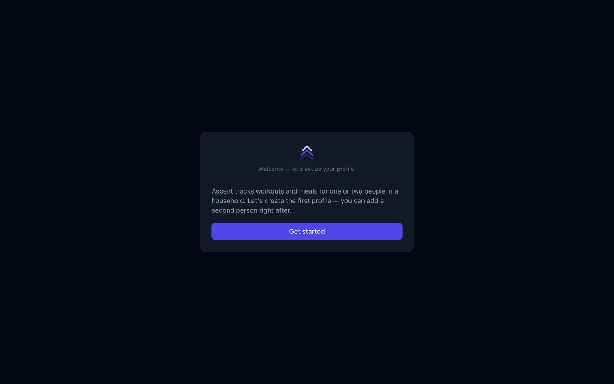
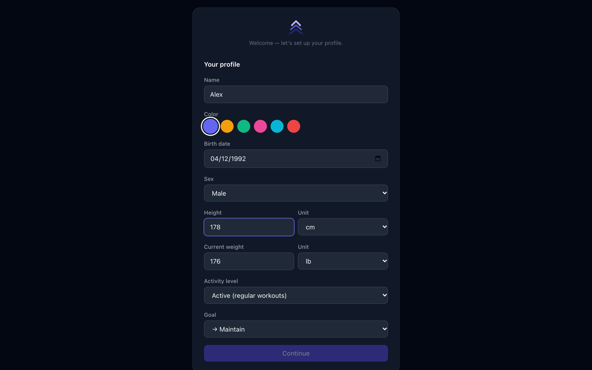
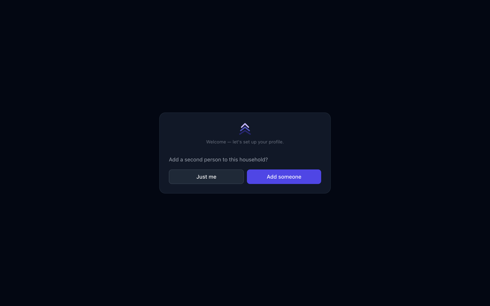
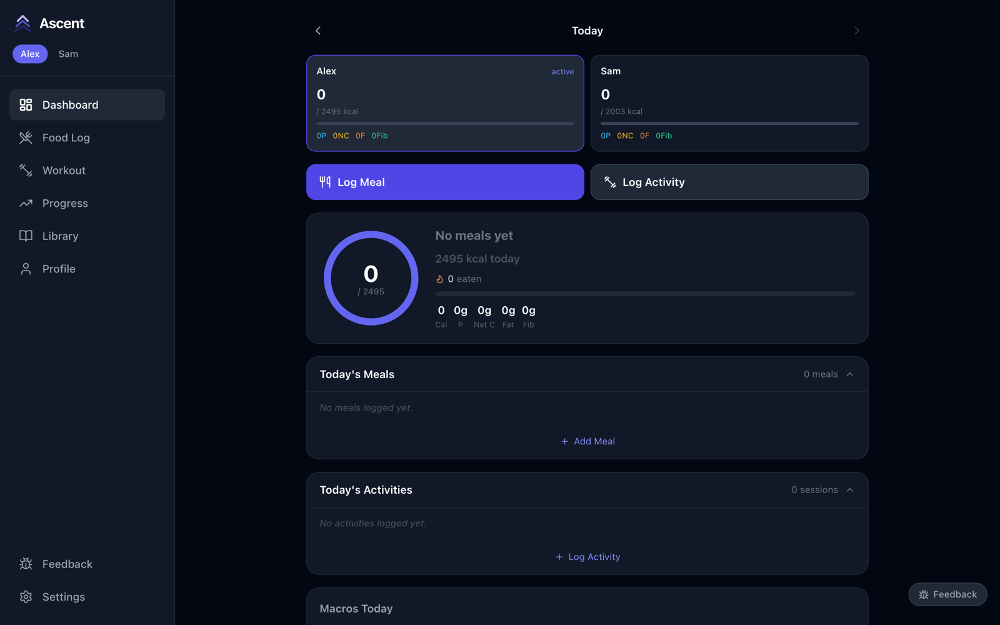

# Getting started

This takes about five minutes. At the end you'll have Ascent running on your computer, a profile for each person, and the app open on your phone.

## 1. What you need

- A Mac or Linux computer that stays on when you want to use the app (it is the server)
- [Node.js 20](https://nodejs.org). If you don't have Node, `setup.sh` installs it through [nvm](https://github.com/nvm-sh/nvm)
- `git`
- Windows isn't supported directly; use [WSL](https://learn.microsoft.com/windows/wsl/) and follow the Linux steps inside it

## 2. Install and start

```bash
git clone https://github.com/anshuman1811/ascent-app.git
cd ascent-app
./setup.sh
./start.sh
```

- `setup.sh` installs the dependencies for the server and the client.
- `start.sh` builds the client and starts the server in the background with [pm2](https://pm2.keymetrics.io), so it keeps running after you close the terminal.

When it finishes it prints where to open the app:

```
Access on this machine:  http://localhost:3001
Access on network:       http://192.168.x.x:3001
```

## 3. Create your profiles

Open http://localhost:3001. A new install has no data, so you land on the welcome screen.



Fill in your details. Check the **units** next to height and weight before you type — they default to feet and pounds. Ascent uses these numbers to work out your daily calorie target, and you can change any of them later under **Profile**.



Next, choose **Just me** or **Add someone** to create a second profile for a partner or housemate.



You then arrive at an empty dashboard, ready for your first meal or workout.



## 4. Open it on your phone or tablet

On any device on the same Wi-Fi, open the **network** address `start.sh` printed (for example `http://192.168.1.20:3001`). Add it to your home screen to use it like an app.

Everyone sees the same data, live. Two useful variations:

- **Split-screen** — on a tablet, add `?users=1,2` to the address (`http://…:3001/?users=1,2`) to show both people side by side.
- **Training together** — if both people have a workout in progress, the dashboard's Resume button becomes **Resume Together** and opens both sessions side by side.

There is no login: anyone on your network who has the address can use the app. Keep it on a home network you trust and don't expose it to the internet.

## 5. Optional extras

### Exercise demo GIFs

Exercises work without them, but you can download short demo animations for about 50 of the most common lifts (needs `python3`); the rest simply show no animation:

```bash
python3 server/scripts/download-exercise-gifs.py
./start.sh
```

They aren't included in this repository because the source dataset is licensed for non-commercial use only.

### AI features

Two features use the Anthropic API and need your own key: describing a meal in plain English in the food log, and **Analyze my progress** on the Progress page. Everything else works without it.

```bash
cp server/.env.example server/.env
# edit server/.env and set ANTHROPIC_API_KEY=...
pm2 restart ascent
```

### Start automatically after a reboot

```bash
pm2 startup     # prints one command — copy and run it
pm2 save
```

## 6. Day-to-day care

| Task | Command |
|---|---|
| See if it's running | `pm2 list` |
| View server logs | `pm2 logs ascent` |
| Restart | `pm2 restart ascent` |
| Stop | `pm2 stop ascent` |
| Update to the latest version | `git pull && ./setup.sh && ./start.sh && pm2 restart ascent` |

### Backing up

All of your data lives in the `data/` folder: `data/fitness.db` (the database) and `data/uploads/` (photos). To take a safe copy while the app is running:

```bash
sqlite3 data/fitness.db ".backup backup-$(date +%F).db"
```

Don't copy `fitness.db` on its own while the app is running — recent entries can still be sitting in the `fitness.db-wal` file next to it. Either use the command above or stop the app first (`pm2 stop ascent`) and copy the whole `data/` folder.

To start over from scratch, stop the app, delete `data/`, and start it again.

## Troubleshooting

**The page doesn't load.** Run `pm2 list`. If `ascent` isn't `online`, run `pm2 logs ascent` to see why.

**Port 3001 is already in use.** Change `PORT: 3001` in `ecosystem.config.js` to a free port, then run `pm2 delete ascent` and `./start.sh`. Use the new port in the address.

**It works on the computer but not on the phone.** Both must be on the same Wi-Fi, and you need the *network* address, not `localhost`. If it still fails, allow incoming connections for Node in the computer's firewall.

**`npm install` fails while building `better-sqlite3`.** Make sure you're on Node 20 (`node --version`). On Linux you may also need build tools: `sudo apt install build-essential python3`.

**`pm2: command not found` in a new terminal.** Load nvm first (`source ~/.nvm/nvm.sh`), or run `npx pm2 …` from the project folder.

## Next

Head to the **[user guide](guide.md)** to set up your routines and start logging.
