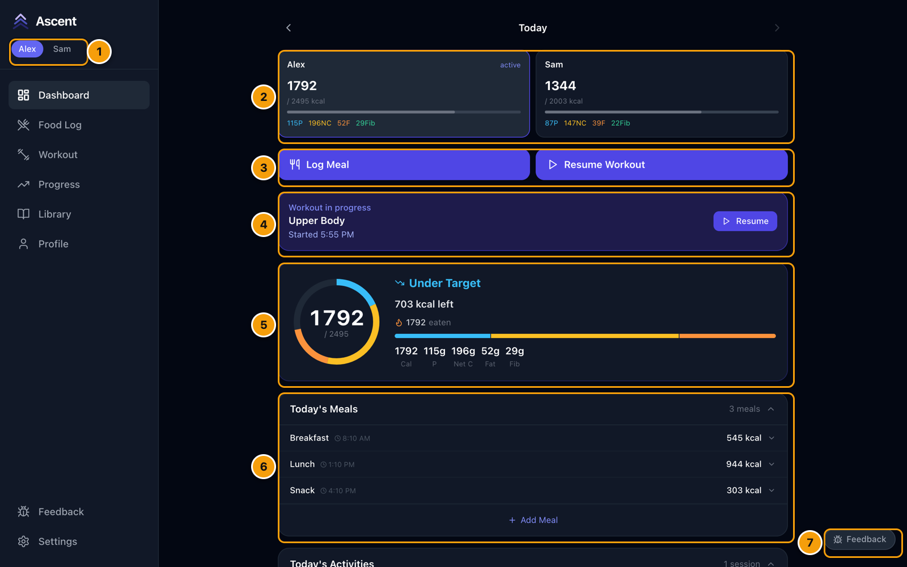
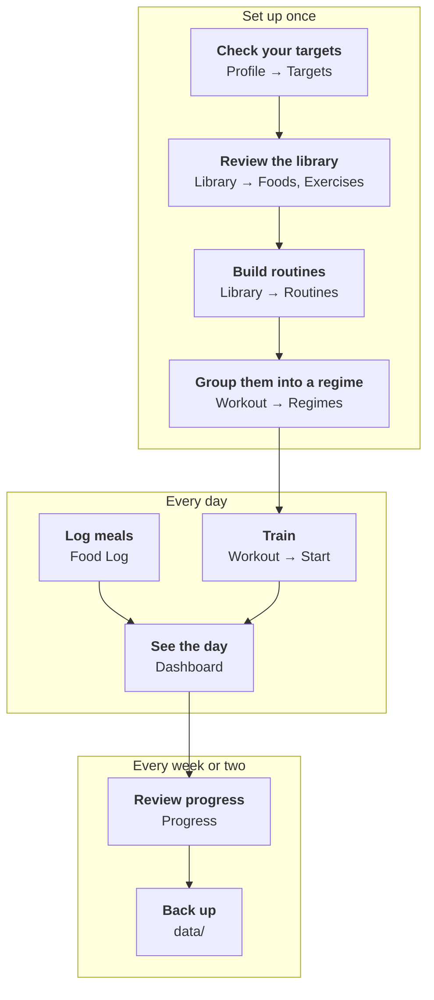

# User guide

Every flow in Ascent, step by step, with a screenshot at each step. If you haven't installed it yet, start with **[Getting started](getting-started.md)**.

The screenshots come from a demo install with two made-up people, Alex and Sam.

## Finding your way around

The **sidebar** (a bar along the bottom on a phone) takes you everywhere. The **names at the top** switch between people; everything you see and log belongs to the highlighted one. The **Dashboard** is today at a glance:

1. **Who's using it** — tap a name to switch person.
2. **Both people's day** — calories eaten against each target, with the macros underneath.
3. **Shortcuts** — log a meal, or start (or resume) a workout.
4. **Workout in progress** — jump back into a session you left.
5. **Today in detail** — the calorie ring and macro bar. The target rises on days you train by the calories you burned.
6. **Today's meals** — expand one to see what's in it, or add another.
7. **Feedback** — note a bug or an idea from any page.

## A sensible order

## The flows

| Page | What it covers |
|---|---|
| **[1. Dashboard and household](guide/01-dashboard.md)** | Reading the dashboard, other days, two people, split-screen, using it on a phone |
| **[2. Logging meals](guide/02-meals.md)** | Adding a meal, searching foods, quantities, new foods on the fly, Recent, Quick log, the AI parser, editing entries |
| **[3. The food library](guide/03-food-library.md)** | Searching, adding a food from its label, building a recipe from ingredients, photos |
| **[4. Exercises and routines](guide/04-exercises-and-routines.md)** | Browsing exercises, adding your own, building a routine, editing, reordering and swapping exercises |
| **[5. Regimes](guide/05-regimes.md)** | Chaining routines into a rotation and seeing what's up next |
| **[6. Training](guide/06-training.md)** | Starting a workout, logging sets, rest timer, PRs, editing, swapping, skipping, timed exercises, finishing, ad-hoc workouts, other activities, training together |
| **[7. History and progress](guide/07-history-and-progress.md)** | Past sessions, personal records, muscle volume, strength trends, AI analysis |
| **[8. Profile, settings and feedback](guide/08-profile-settings-feedback.md)** | Targets, tracked macros, weight, units, app settings, reporting feedback |
| **[9. Offline use and sync](guide/09-offline-and-sync.md)** | What works without a connection, the sync indicator, what happens when two devices change the same thing |
