# User guide

How to set Ascent up for the way you train and eat, and how to use it day to day. If you haven't installed it yet, start with **[Getting started](getting-started.md)**.

The screenshots use two made-up people, Alex and Sam.

- [Finding your way around](#finding-your-way-around)
- [Set up: targets](#set-up-targets)
- [Set up: the library](#set-up-the-library)
- [Set up: routines](#set-up-routines)
- [Set up: regimes](#set-up-regimes)
- [Daily use: workouts](#daily-use-workouts)
- [Daily use: meals](#daily-use-meals)
- [Reviewing progress](#reviewing-progress)
- [Two people, one screen](#two-people-one-screen)
- [Feedback](#feedback)

## Finding your way around

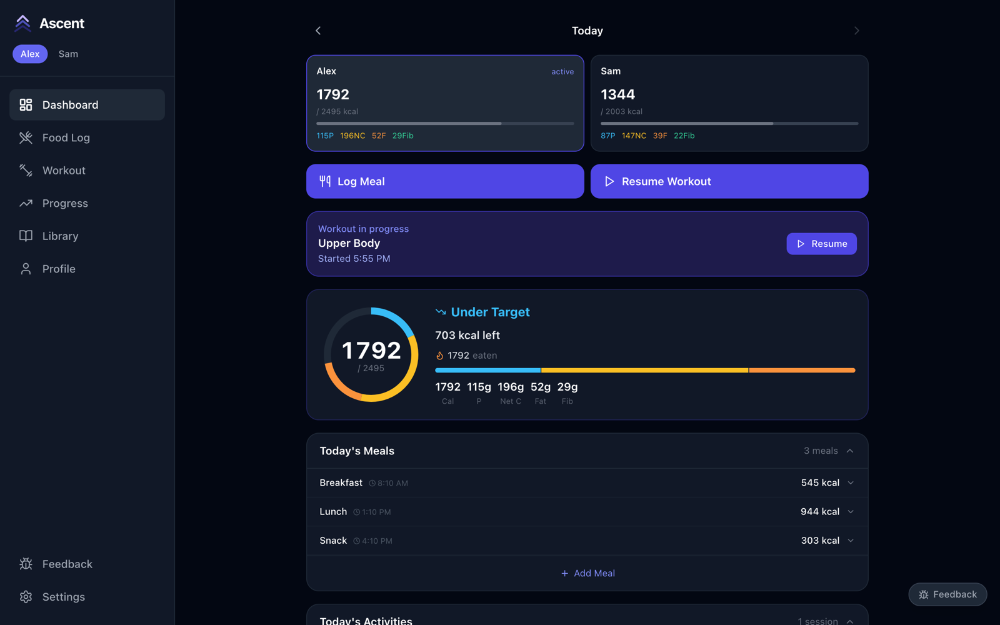

- The **names at the top left** switch between people. Everything you see and log belongs to the highlighted person.
- **Dashboard** is today at a glance: calories and macros against your target, today's meals and activity, and shortcuts to log a meal or start (or resume) a workout. The arrows beside **Today** move to other days.
- **Food Log**, **Workout** and **Progress** are the three things you do most.
- **Library** holds the shared building blocks: foods, exercises and routines.
- **Profile** holds your targets, weight history and unit preferences.

A sensible order for a new install: targets → check the library → build routines → group them into a regime → start logging.

## Set up: targets

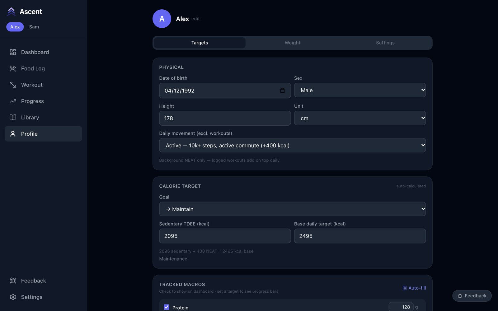

**Profile → Targets** is filled in from what you entered at onboarding, and recalculates whenever you change something.

- **Daily movement** is your background activity *excluding* workouts (steps, commute, an active job). Logged workouts are added on top each day, so don't count them here.
- **Goal** shifts the target down for a cut or up for a bulk.
- **Base daily target** is what you eat on a rest day. On a day you train, the dashboard raises the target by the calories you burned.
- **Tracked macros** — tick the ones you want on the dashboard and give each a target; **Auto-fill** suggests values.

**Profile → Weight** is where you log body weight. The latest entry is used for calorie-burn estimates, so update it now and then.

## Set up: the library

The library is shared by everyone in the household.

### Exercises

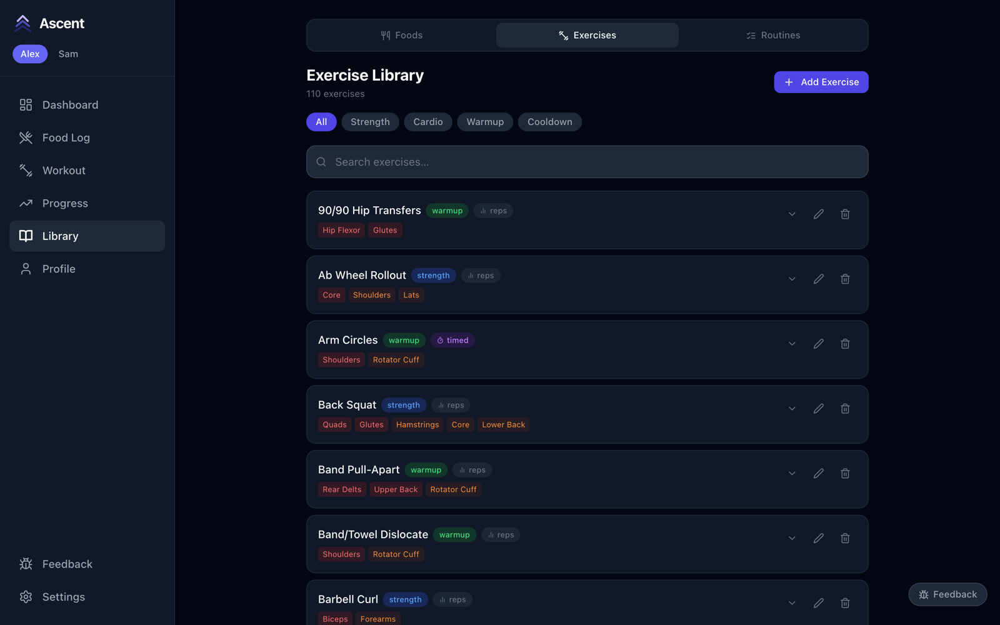

110 exercises are included, tagged as strength, cardio, warmup or cooldown, and as **reps** or **timed**. Expand one to see its technique notes and muscle map. Use **Add Exercise** for anything missing — pick the muscles it works so it counts toward your muscle-volume chart.

### Foods

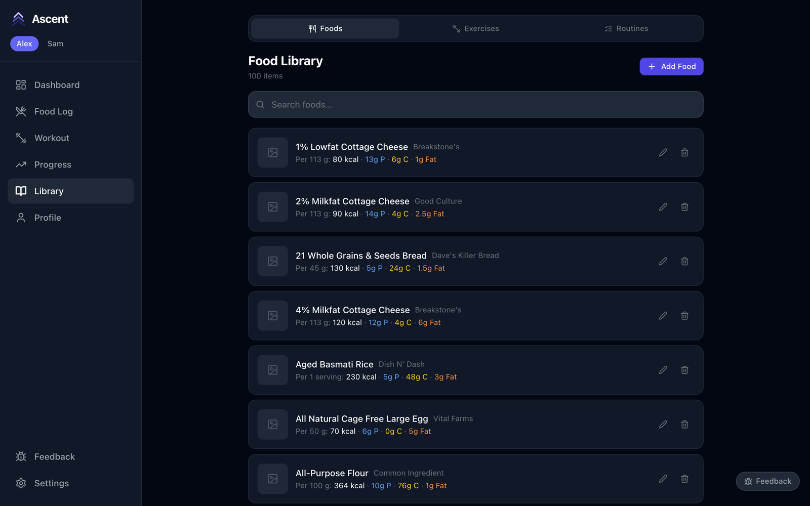

100 common foods are included. Add your own from the nutrition label: enter the serving size and the values for that serving, and Ascent scales them to whatever amount you log. A food can also be a **recipe** made of other foods as ingredients.

## Set up: routines

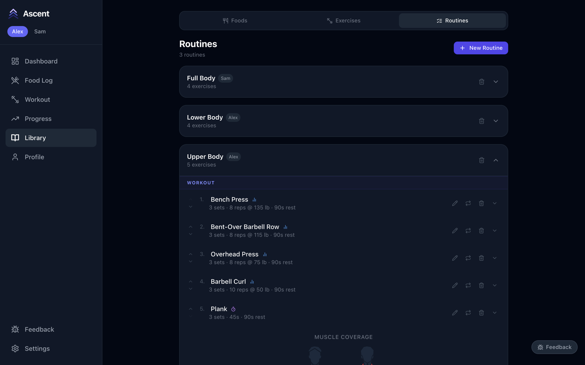

A routine is an ordered list of exercises with targets. Go to **Library → Routines → New Routine**, then add exercises and set for each one:

- sets and reps (or seconds, for timed exercises)
- starting weight
- rest between sets

Use the arrows to reorder, the swap icon to replace an exercise while keeping its targets, and expand the routine to see which muscles it covers overall. Each routine belongs to the person who was active when it was created.

## Set up: regimes

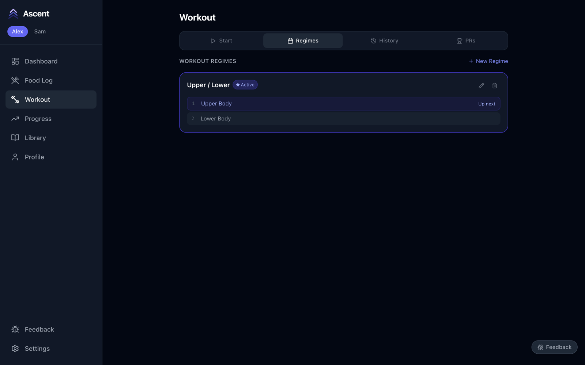

A regime is a rotation of routines — Upper / Lower, Push / Pull / Legs, and so on. Create one under **Workout → Regimes → New Regime**, add your routines in order, and press **Set as active**. From then on Ascent marks the next routine in the rotation as **Up next**, so you never have to remember where you left off. It follows the order, not the calendar: skip a day and the same routine is still waiting.

## Daily use: workouts

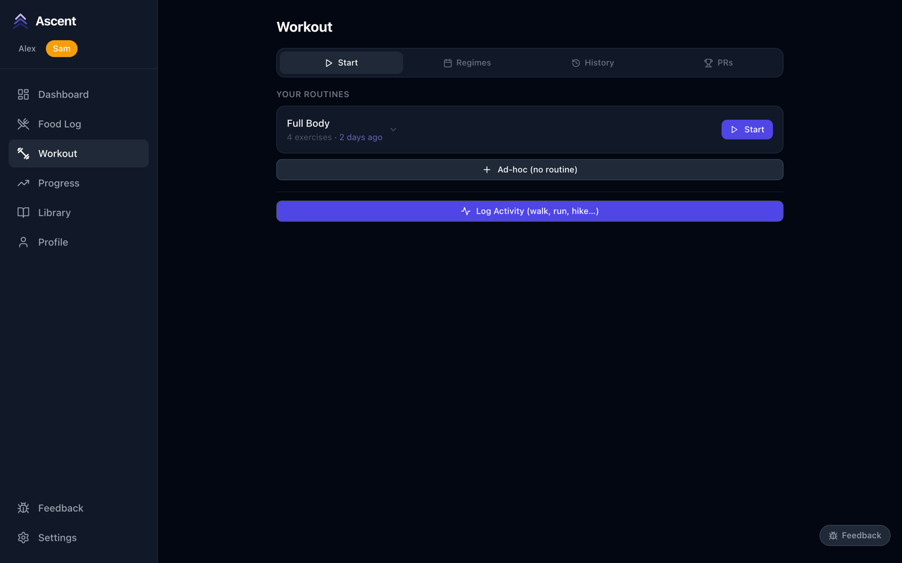

On **Workout → Start**, press **Start** on a routine, or choose **Ad-hoc** to build a session as you go. **Log Activity** records a walk, run or hike without the set-by-set tracking.

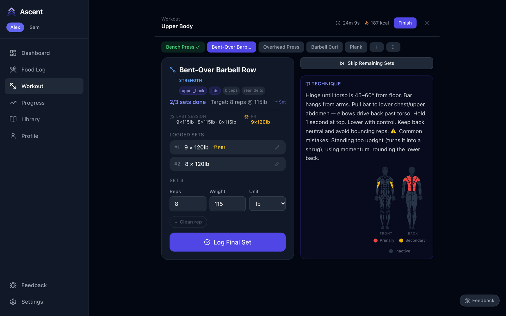

During a session:

- The **tabs** across the top are your exercises; green means done. The **+** adds an exercise and the grip icon reorders them.
- Each card shows your **target**, what you did **last session**, and your **PR** for that exercise.
- Enter reps and weight and press the **Log Set** button. The rest timer starts on its own, and keeps time on every device showing the session.
- A set that beats your record is flagged **PR!** straight away. The PR is the heaviest weight you've lifted for at least 4 reps and, at that weight, the most reps.
- Made a mistake? The **pencil** on a logged set edits or deletes it. **Clean rep** lets you mark a set as assisted.
- **Skip Remaining Sets** moves on early; a skipped exercise can be un-skipped.
- The header shows elapsed time and estimated calories. The workout saves itself when the last exercise is done, or press **Finish** to end early.

Past sessions are under **Workout → History**, and every record under **Workout → PRs**.

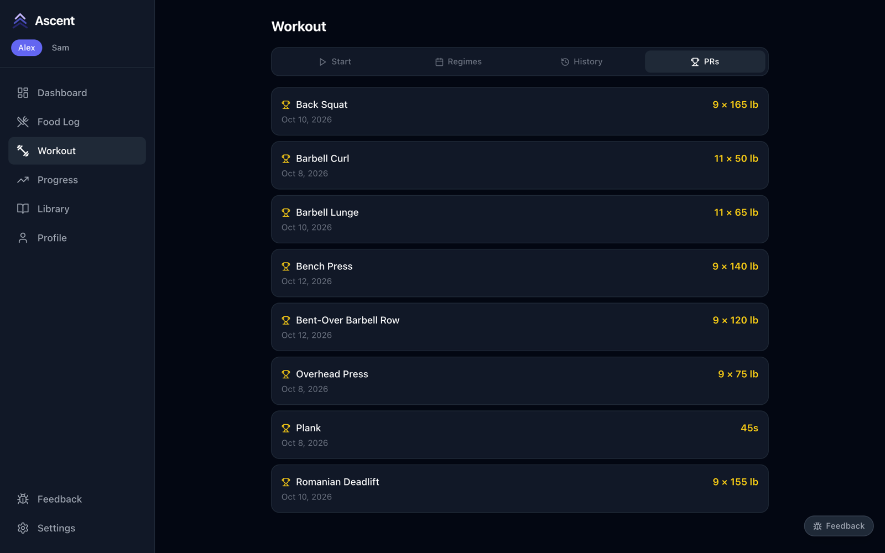

## Daily use: meals

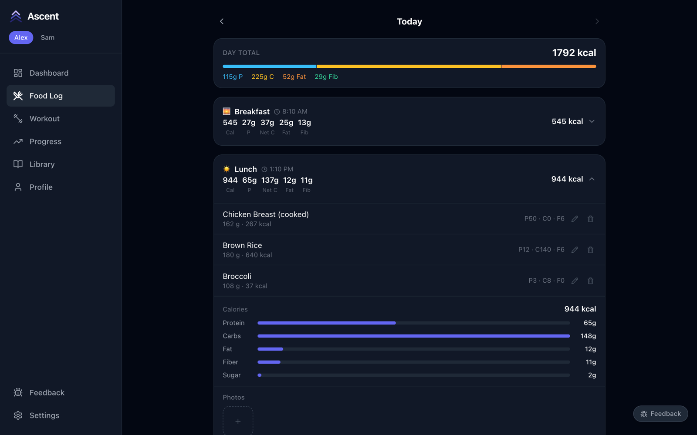

In **Food Log**, press **Add Meal**, pick the meal type, and add foods with a quantity. Three shortcuts make it faster:

- **Recent** — re-log things either of you ate lately with one tap.
- **AI Food Parser** — describe the meal in plain English and review what it found (needs an API key; see [Getting started](getting-started.md#ai-features)).
- **Log Meal** on the dashboard opens the same form.

Expand a meal to see or change its items. The day total at the top and the dashboard ring update as you go.

## Reviewing progress

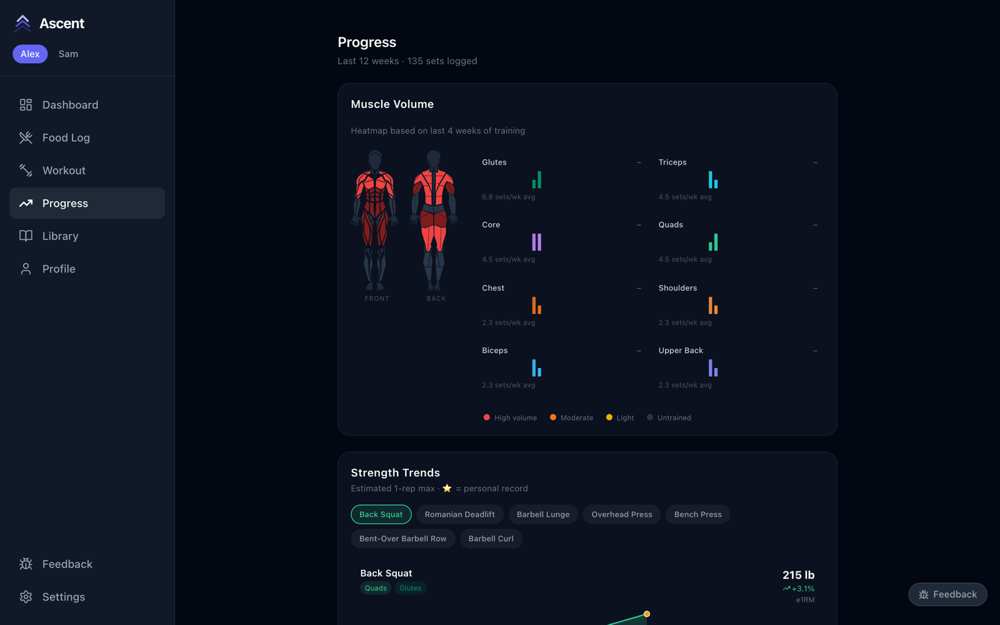

**Progress** covers the last 12 weeks:

- **Muscle Volume** — sets per week for each muscle group, with a heatmap of the last four weeks, to spot what you're neglecting.
- **Strength Trends** — estimated one-rep max over time for each lift, with PRs starred.
- **Analyze my progress** — an optional AI-written summary of your recent training (needs an API key).

## Two people, one screen

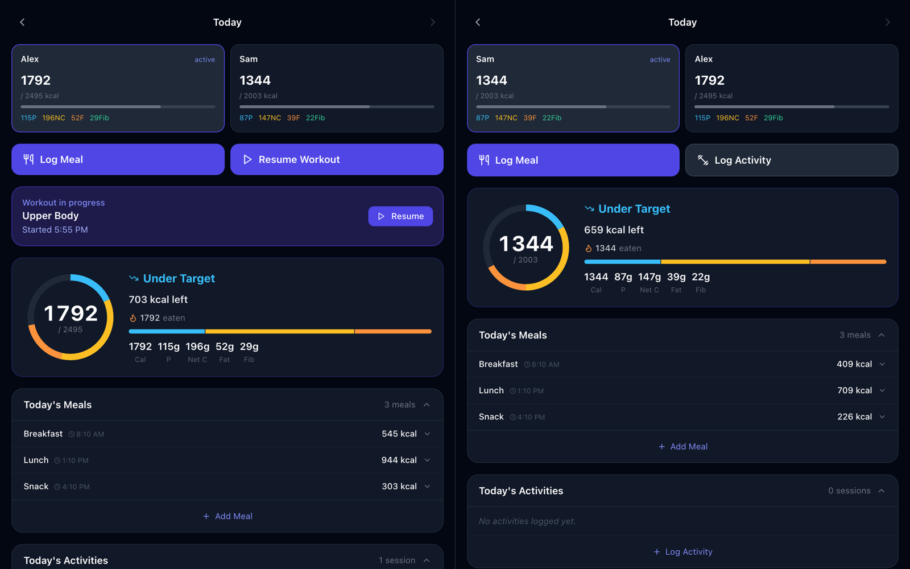

Add `?users=1,2` to the address to show both people side by side — handy on a tablet in the kitchen or gym. Each half works independently. If you're both mid-workout, **Resume Together** on the dashboard opens both live sessions side by side.

## Feedback

The **Feedback** button in the corner of every page saves a note — a bug or an idea — along with the page you were on. Notes are stored in your own database and listed under **Feedback** in the sidebar; nothing is sent anywhere.
