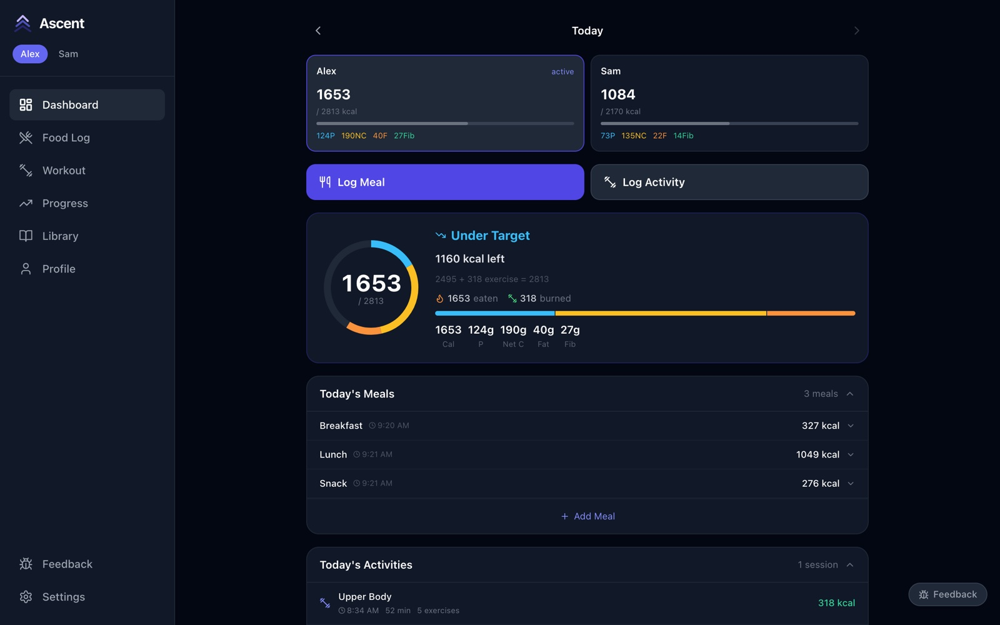
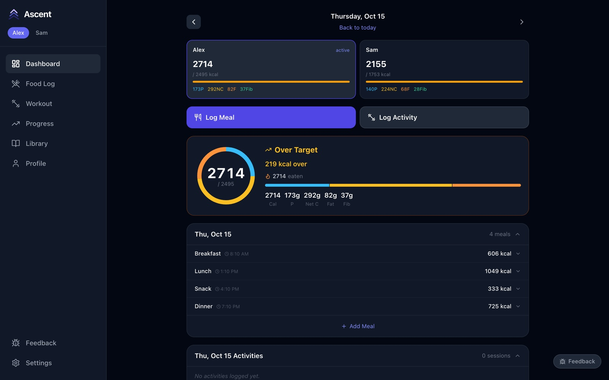
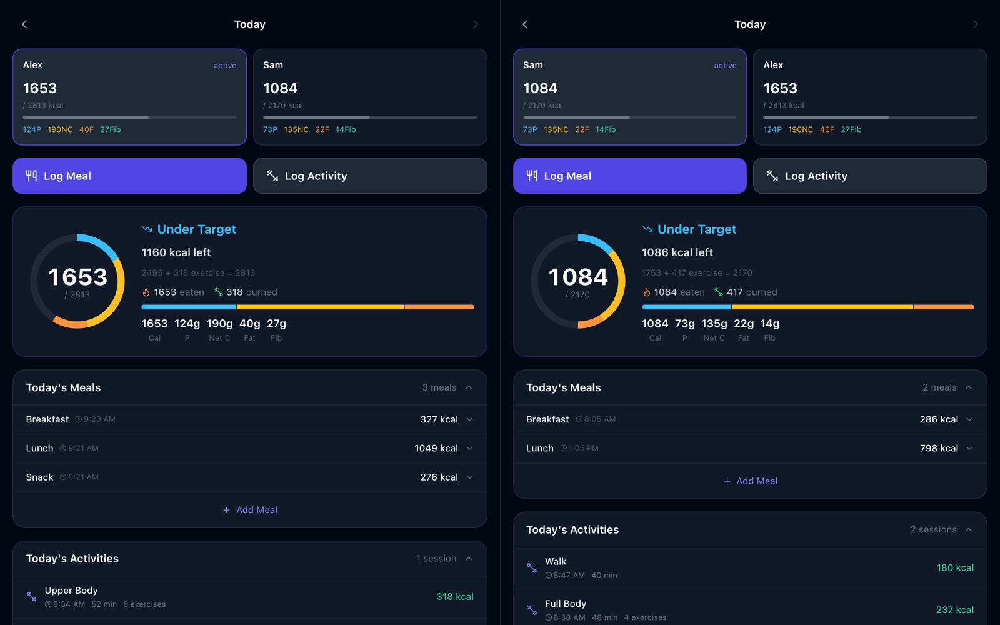
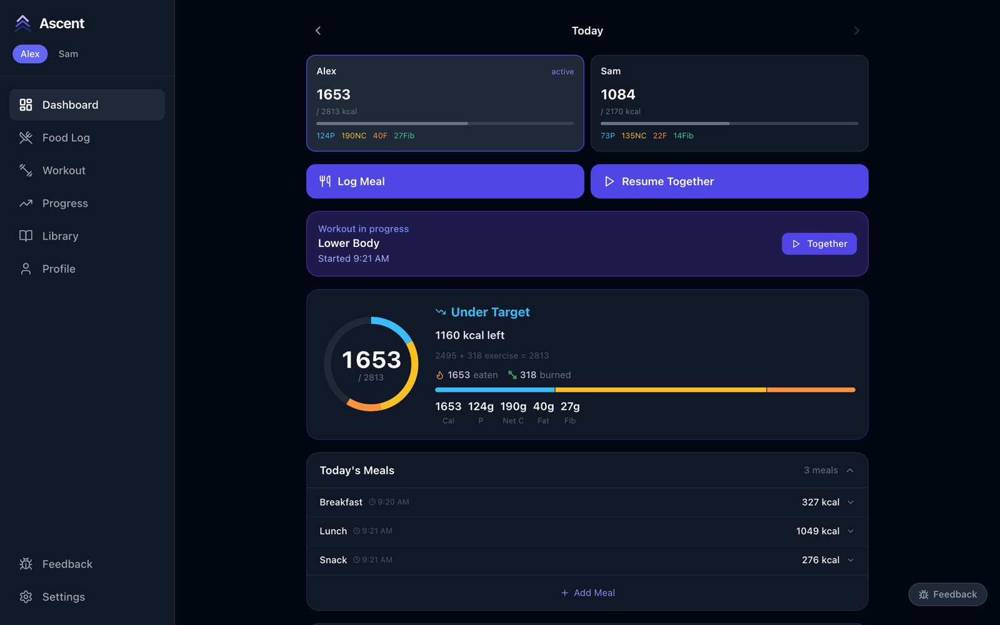
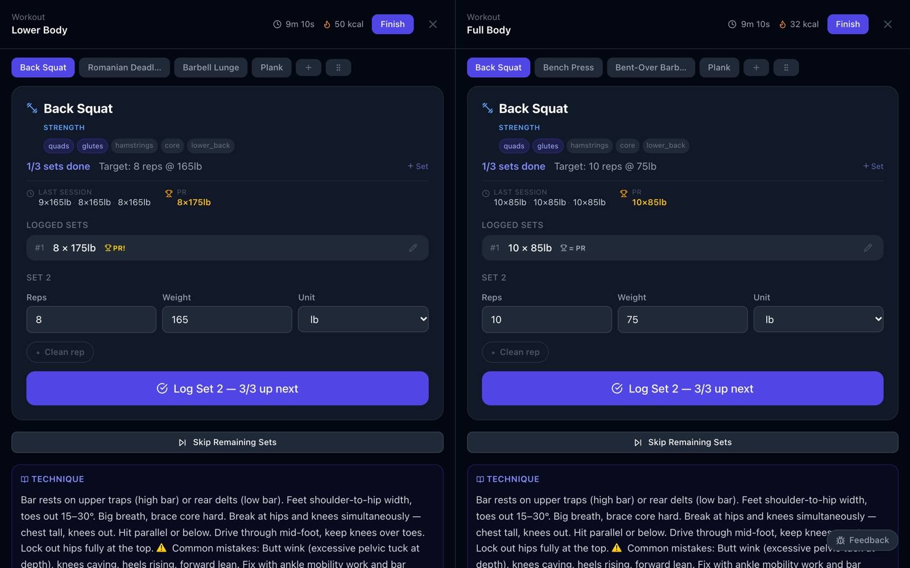
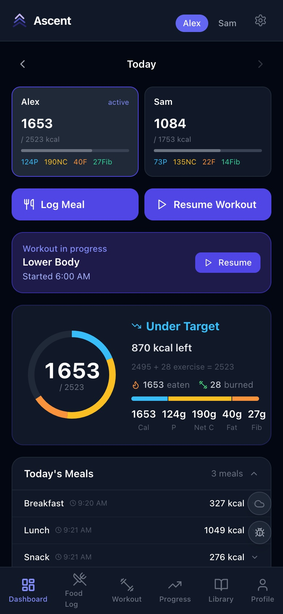
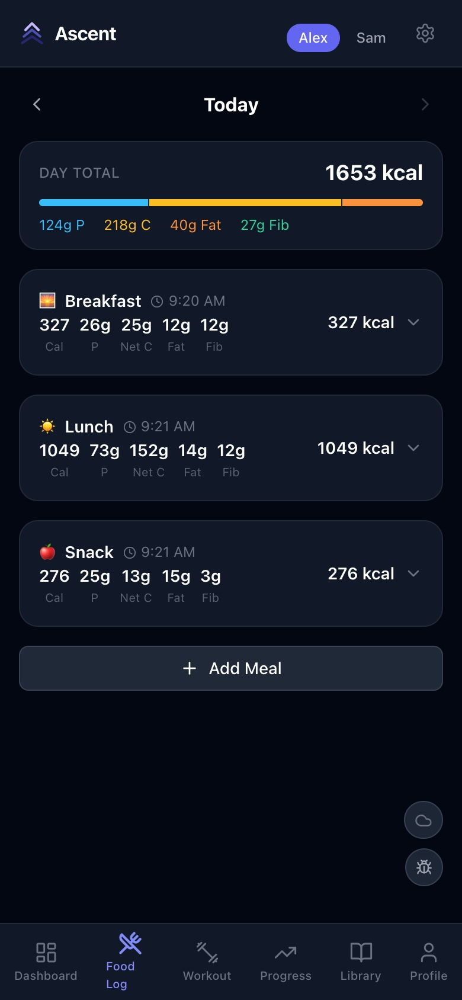
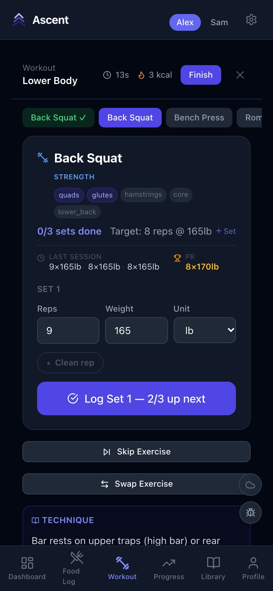

# 1. Dashboard and household

[← User guide](../guide.md) · Next: [Logging meals →](02-meals.md)

## Reading the dashboard

- **The two cards at the top** show each person's calories eaten against their target, with protein (P), net carbs (NC), fat (F) and fiber (Fib) underneath. The highlighted card is the active person.
- **Log Meal** opens the meal form. **Log Activity** lets you either start a tracked workout or record one you've already done (a run, a class). While a workout is in progress it becomes **Resume Workout**.
- **The ring** fills as you eat. Its colour tells you where you stand — under target, on target, or over. The line under "kcal left" shows how the target was worked out: your base target plus whatever you burned training today.
- **Today's Meals** and **Today's Activities** list what's been logged. Tap a meal to expand it.

## Looking at another day

Use the **‹** and **›** arrows beside **Today**. The whole dashboard switches to that day, and **Back to today** brings you back.

## Switching between people

Tap a name at the top of the sidebar (or the header on a phone). Everything — dashboard, food log, workouts, progress, profile — switches to that person. The food and exercise library is shared.

## Both people on one screen

On a tablet or a wide screen, open `?users=1,2` after the address — for example `http://192.168.1.20:3001/?users=1,2` — or use **Settings → Open split-screen**. Each half is a full copy of the app for one person.

## Training together

When both people have a workout in progress, the dashboard's Resume button becomes **Resume Together**:

It opens both live workouts side by side, so one tablet can track two people at once:

## On a phone

Ascent works the same on a phone. The sidebar becomes a bar along the bottom, and the person switcher moves to the header. Add the page to your home screen to open it like an app.

| Dashboard | Food log | Live workout |
|---|---|---|
|  |  |  |
