# 2. Logging meals

[← Dashboard and household](01-dashboard.md) · Next: [The food library →](03-food-library.md)

Meals live on the **Food Log** page. Each meal has a type (breakfast, lunch, dinner, snack, pre- or post-workout) and any number of foods.

## Add a meal

1. Open **Food Log**. A new day starts empty.

   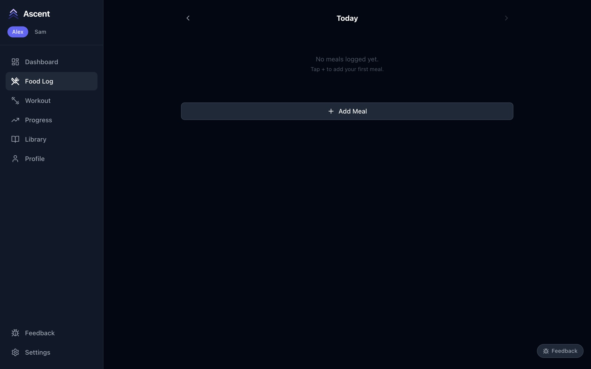

2. Press **Add Meal**, choose the meal type, and press **Add Meal** again. (**Log Meal** on the dashboard does the same.)

   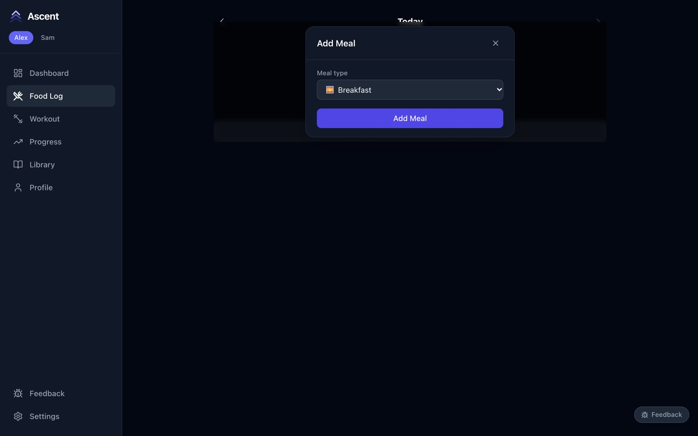

3. The **Add Food to Meal** window opens. Start typing in **Search food**. The chips at the top are quick searches for restaurant dishes in the library; **Recent**, **Quick log** and **AI** are covered below.

   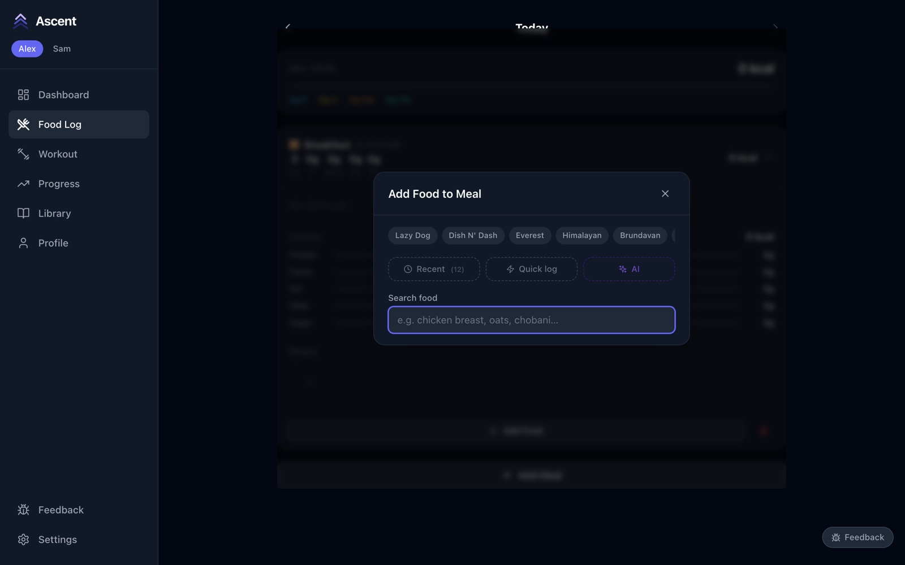

4. Pick a food, then set the **quantity** and unit. The macros for that amount update as you type. Press **Add to Meal**.

   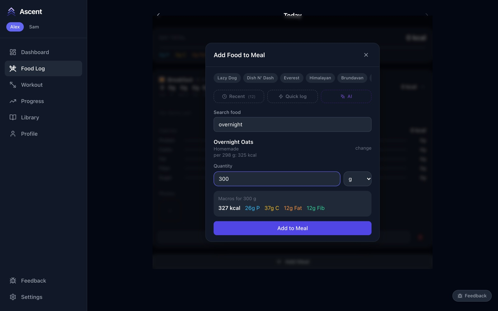

5. The window stays open so you can add the next food. Close it when the meal is complete.

## A food that isn't in the library yet

If a search finds nothing, choose **Add new food…**. Enter the serving size and the values from the label for that serving; the food is saved to the library and added to the meal.

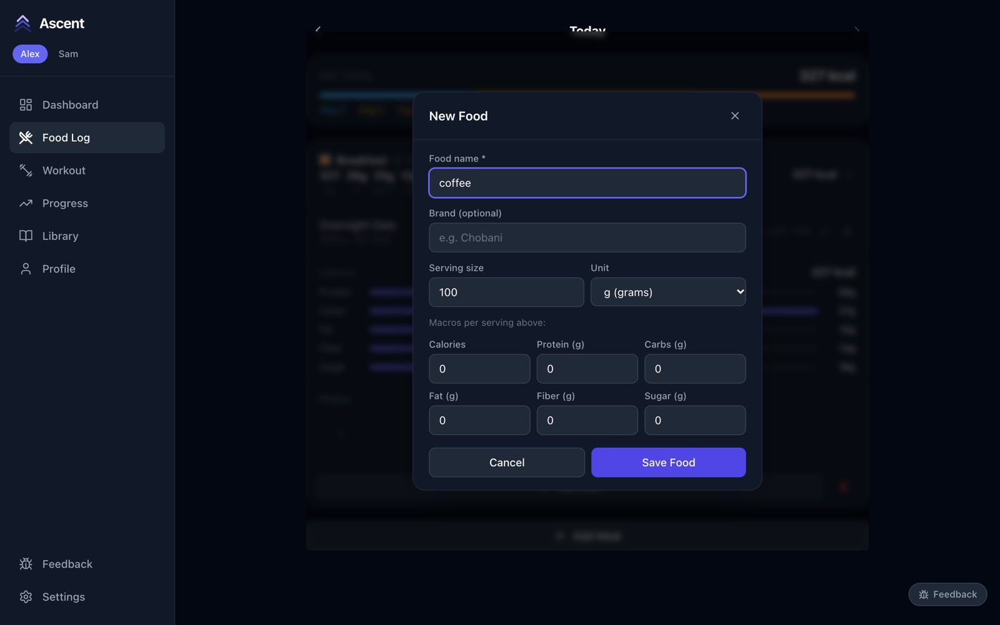

## Re-log something from Recent

**Recent** lists the foods either of you logged lately, with the amount used last time. Tap **+** to add one to this meal at that amount.

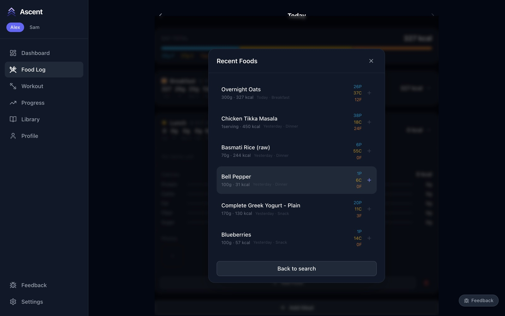

## Quick log

For a one-off — a dish at a restaurant, a snack with no label — **Quick log** records calories and macros without creating a library food. Its **Ingredients** tab builds the entry from library foods instead.

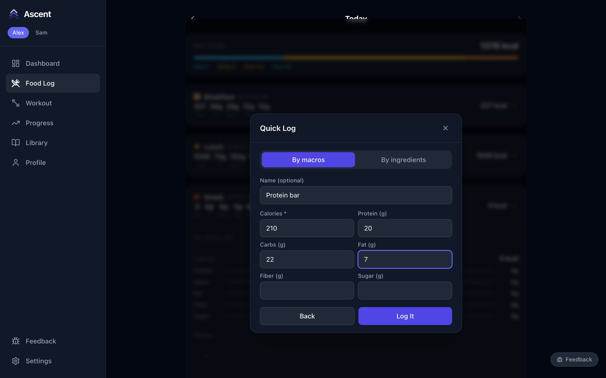

## Describe it to the AI parser

**AI** turns a plain-English description into separate foods with estimated amounts and macros, which you review and adjust before logging.

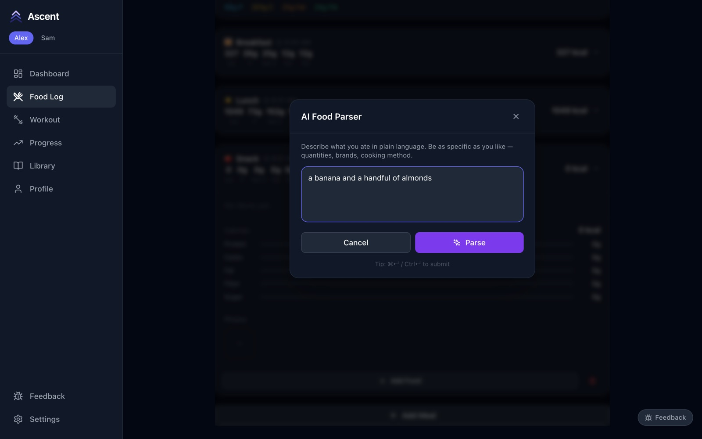

It needs an Anthropic API key (see [Getting started → AI features](../getting-started.md#ai-features)). Without one, it tells you so:

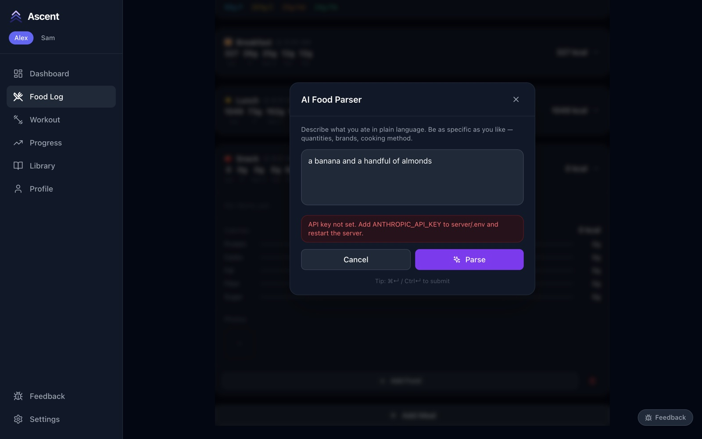

## Review and edit the day

The **Day Total** sums everything you've logged. Each meal shows its calories and macros; tap one to expand it.

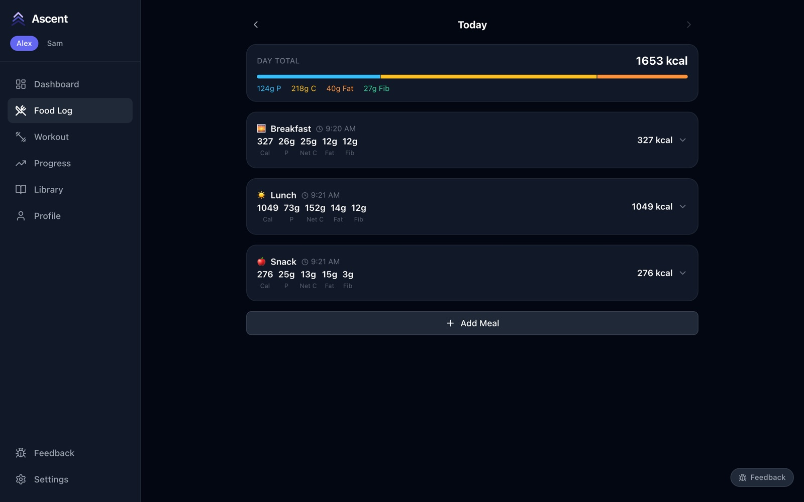

An expanded meal lists its foods and a macro breakdown:

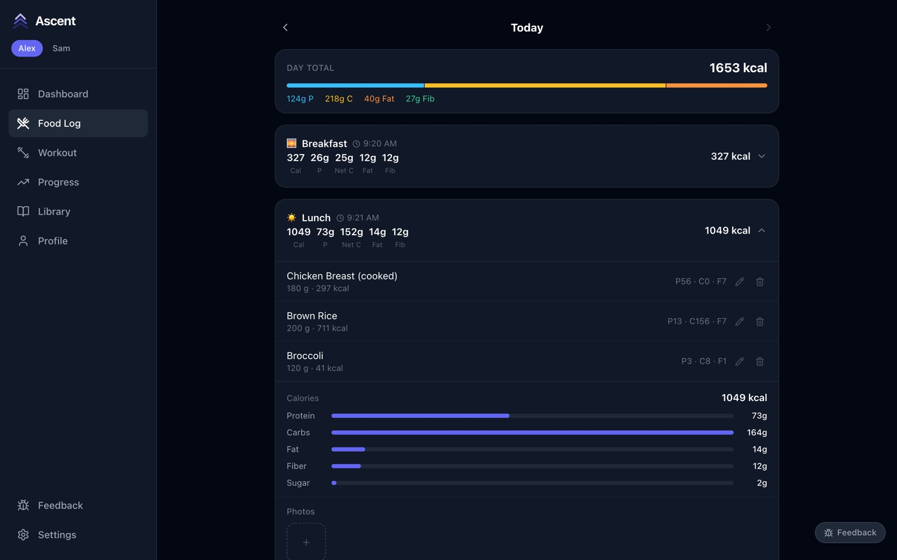

- **Pencil** — change the quantity or override the numbers for that entry. This changes only what you logged, not the food in the library.
- **Bin** — remove the entry.
- **Add Food** — add more to this meal.

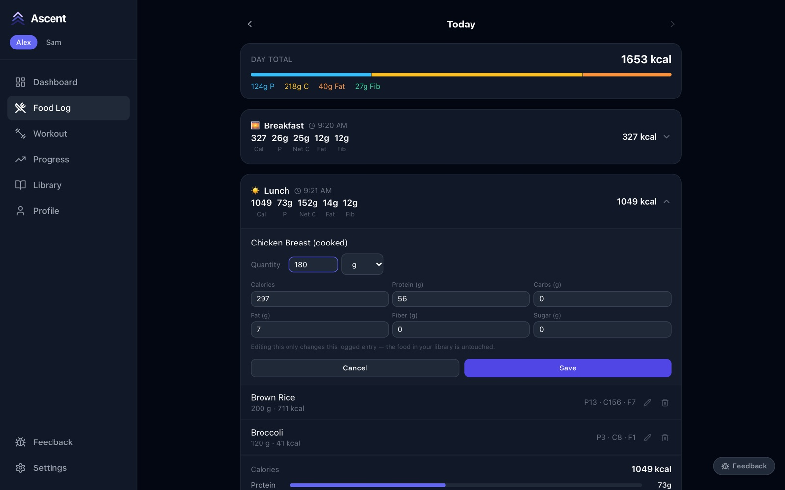

## Log or fix another day

Use the **‹** and **›** arrows beside the date to move between days, then add or edit meals as usual — handy for catching up on yesterday.

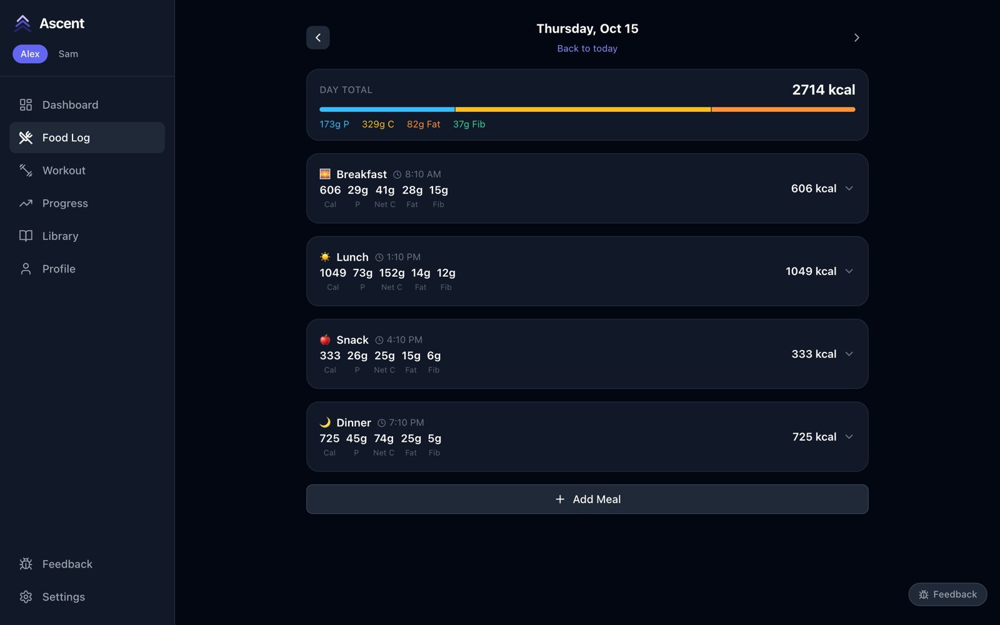
