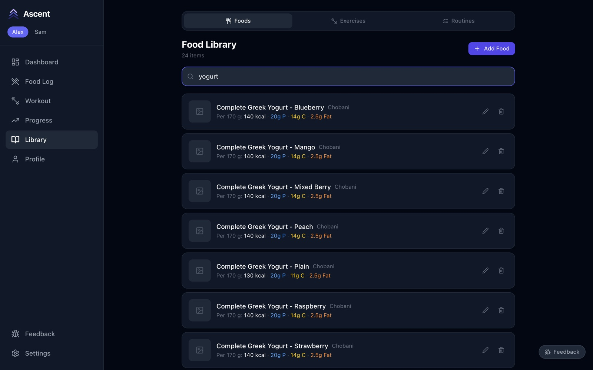
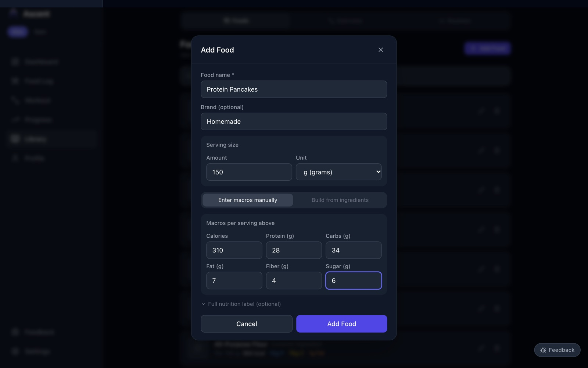
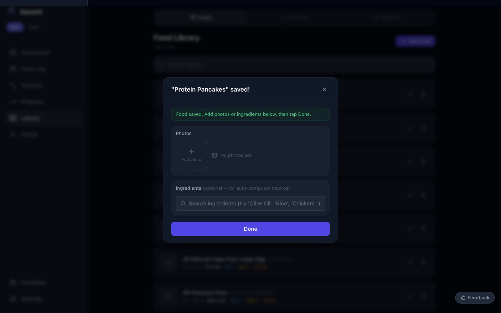
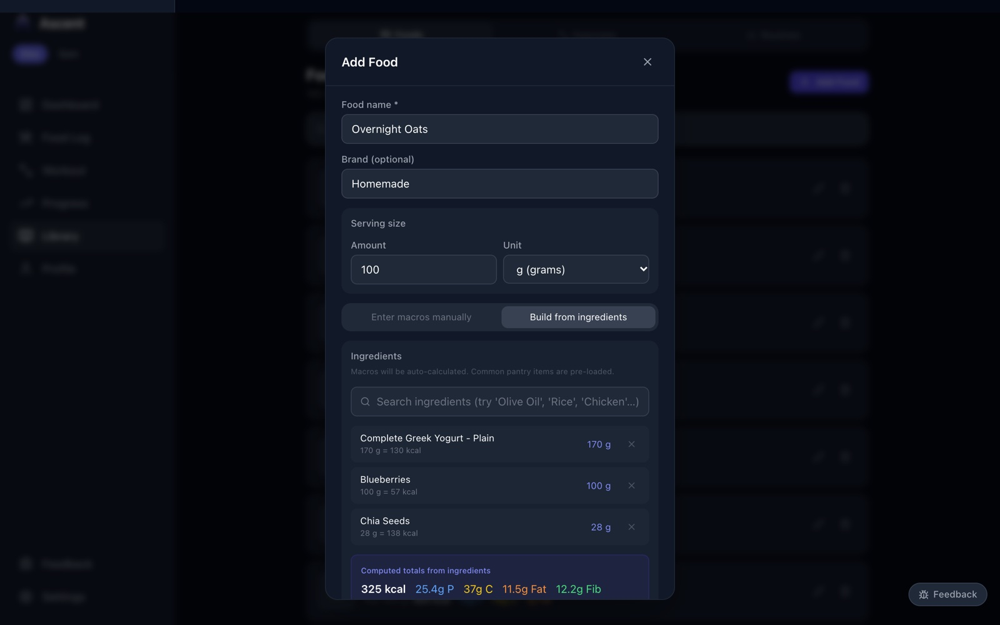

# 3. The food library

[← Logging meals](02-meals.md) · Next: [Exercises and routines →](04-exercises-and-routines.md)

**Library → Foods** holds every food you can log. It starts with 100 common foods and is shared by everyone in the household.

## Search

Type in the search box to filter by name or brand. Each row shows the serving size, calories and macros; the pencil edits a food and the bin deletes it.

## Add a food from its nutrition label

1. Press **Add Food**.
2. Enter the name and, optionally, the brand.
3. Set the **serving size** exactly as printed on the label (for example 150 g or 1 cup).
4. Under **Enter macros manually**, type the values for that serving. **Full nutrition label** reveals saturated fat, cholesterol, sodium and potassium.
5. Press **Add Food**.

When you log the food later, Ascent scales these numbers to whatever amount you enter.

## Add photos

Once a food is saved you can attach photos — the package, the label, the plated dish — then press **Done**.

## Build a recipe from ingredients

For something you cook, choose **Build from ingredients** instead of entering macros:

1. Search for each ingredient and pick it. Each one is added with a default amount; tap the amount to change it.
2. The **Computed totals** box adds them up as you go.
3. Set the **serving size** to the total weight of the dish, so a logged portion is scaled correctly.
4. Press **Add Food**.

