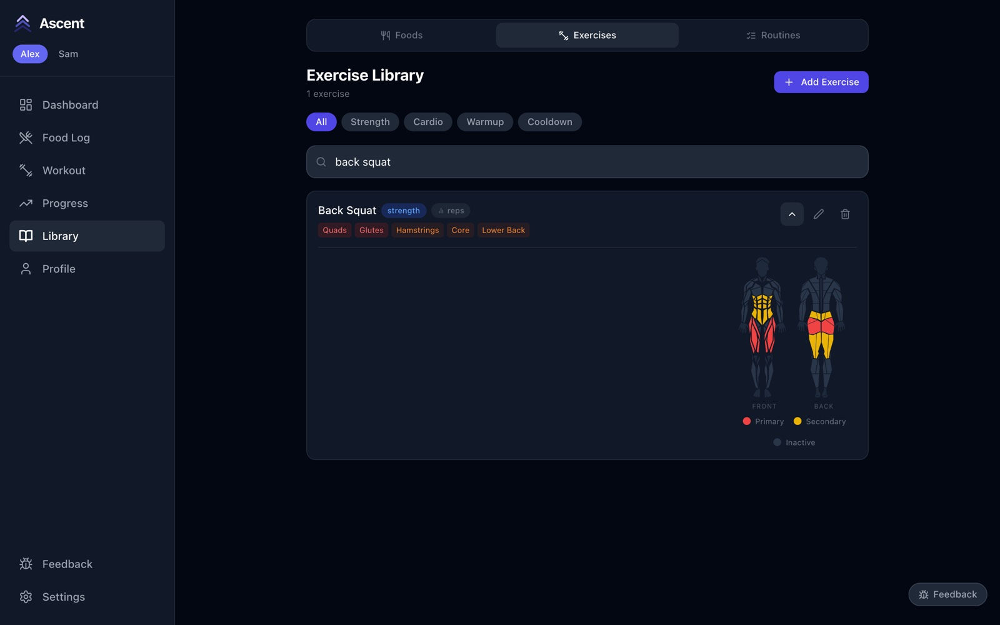
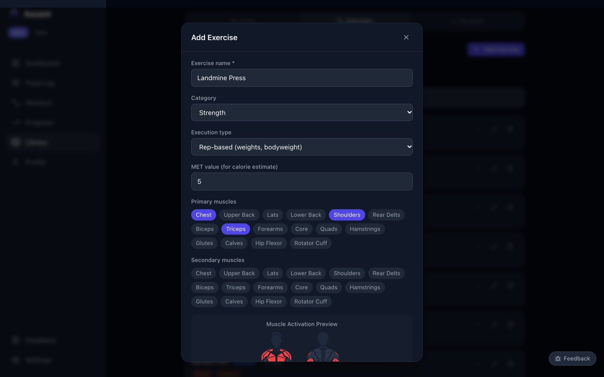
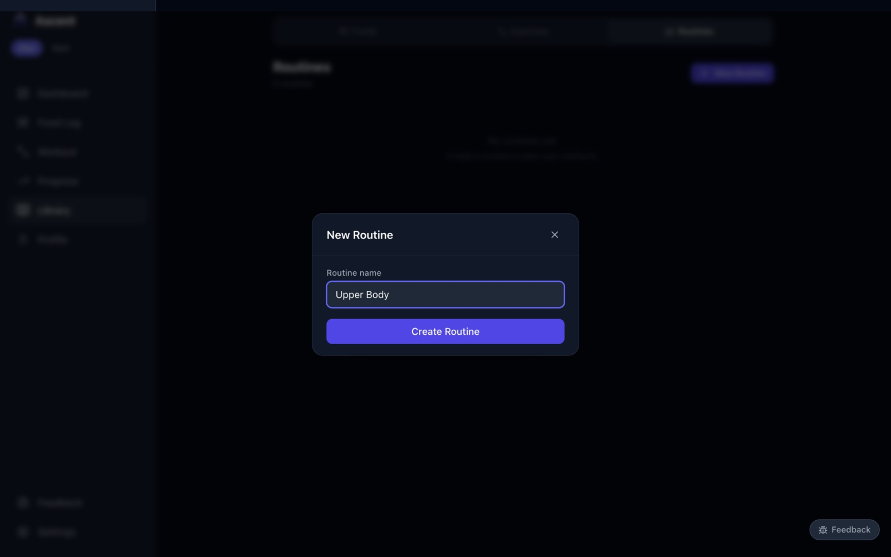
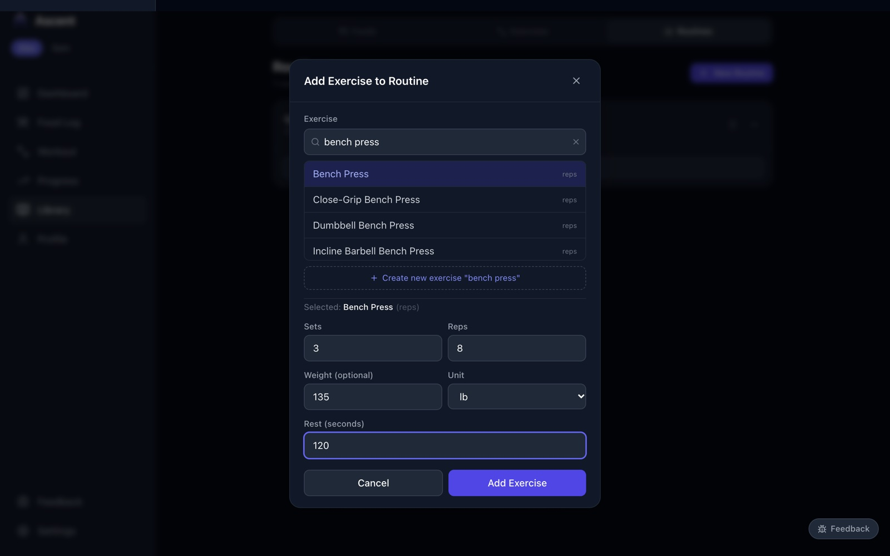
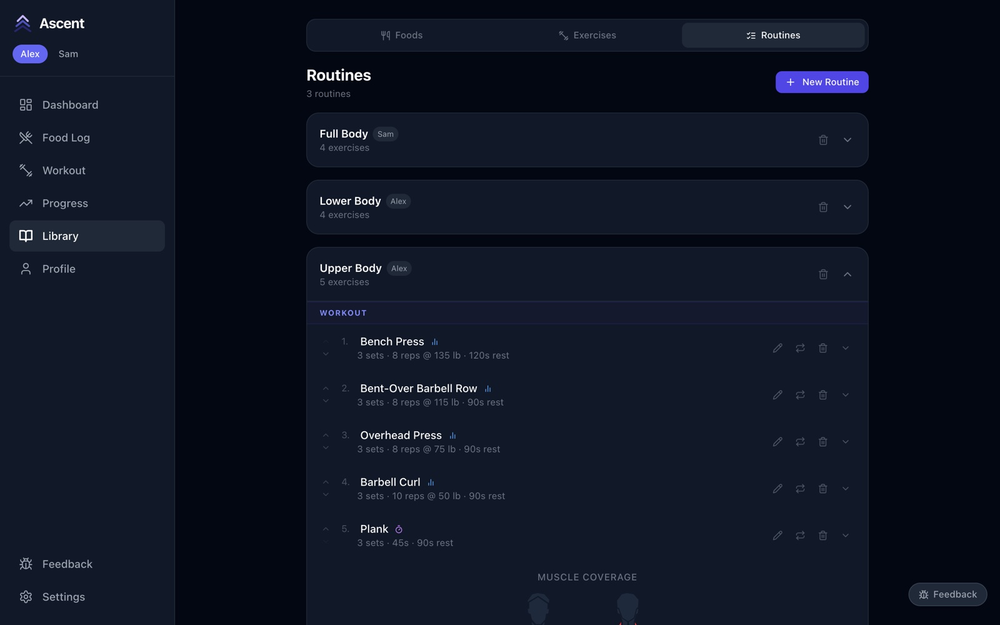
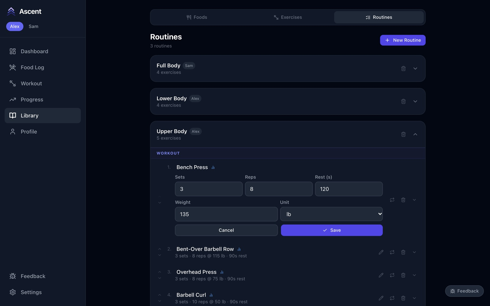
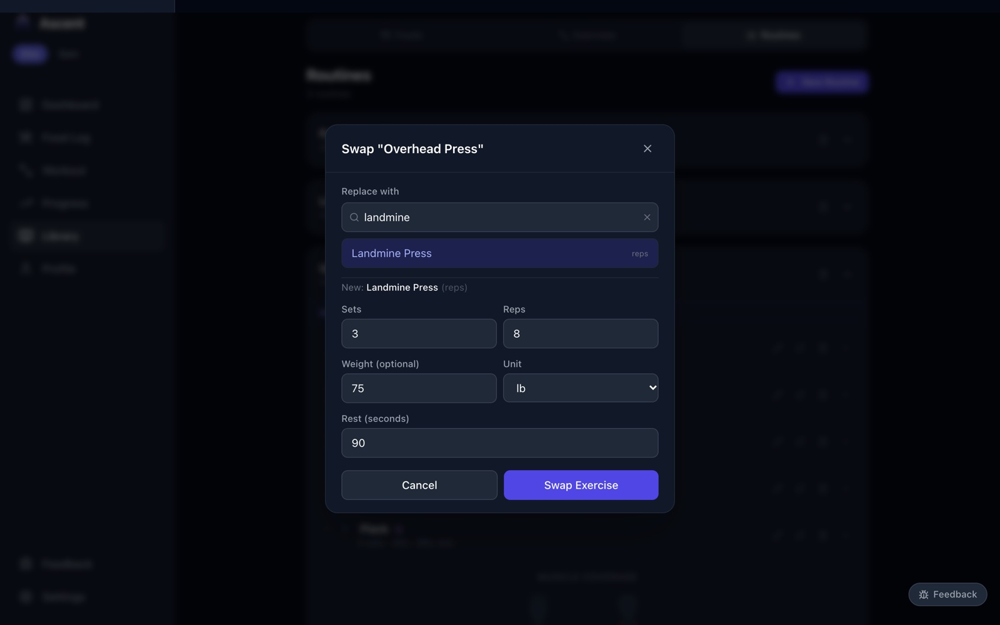

# 4. Exercises and routines

[← The food library](03-food-library.md) · Next: [Regimes →](05-regimes.md)

## Browse the exercise library

**Library → Exercises** lists 110 exercises, shared by everyone. Filter by **Strength**, **Cardio**, **Warmup** or **Cooldown**, or search by name. Each row shows the category, whether it's counted in **reps** or **timed**, and the muscles it works.

Tap the arrow on an exercise to see its technique notes, its muscle map (red = primary, yellow = secondary) and, where available, a demo animation.

## Add your own exercise

1. Press **Add Exercise**.
2. Enter the **name**, choose a **category** and the **execution type**: *Rep-based* for sets of reps (with or without weight), *Timed* for holds like a plank.
3. **MET value** is used to estimate calories burned — around 3–4 for light work, 5–6 for heavy compound lifts.
4. Tap the **primary** and **secondary muscles**. The preview below shows the result, and these feed the muscle-volume chart on the Progress page.
5. Optionally add a **technique description** and a link to an animation, then save.

## Build a routine

A routine is a saved workout: an ordered list of exercises with targets. It belongs to the person who is active when you create it.

1. Go to **Library → Routines** and press **New Routine**. Give it a name and press **Create Routine**.

   

2. Open the routine and press **Add Exercise**. Search for an exercise and pick it — or choose **Create new exercise** if it's missing. Set the **sets**, **reps** (or seconds for a timed exercise), an optional starting **weight**, and the **rest** between sets. Press **Add Exercise**.

   

3. Repeat for each exercise. The routine shows every exercise with its targets, and **Muscle coverage** at the bottom shows what the whole routine works.

   

## Change a routine

Each exercise in a routine has the same controls:

| Control | What it does |
|---|---|
| **▲ ▼** | Move the exercise up or down |
| **Pencil** | Edit sets, reps, rest and weight in place, then **Save** |
| **Swap** (two arrows) | Replace it with another exercise, keeping the targets |
| **Bin** | Remove it from the routine |

Changes apply to future workouts; workouts you've already done keep what you actually did.
