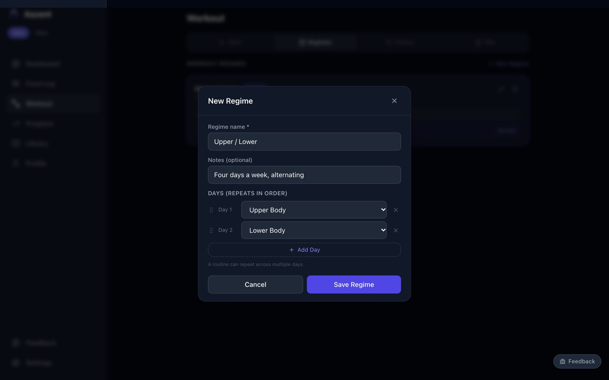
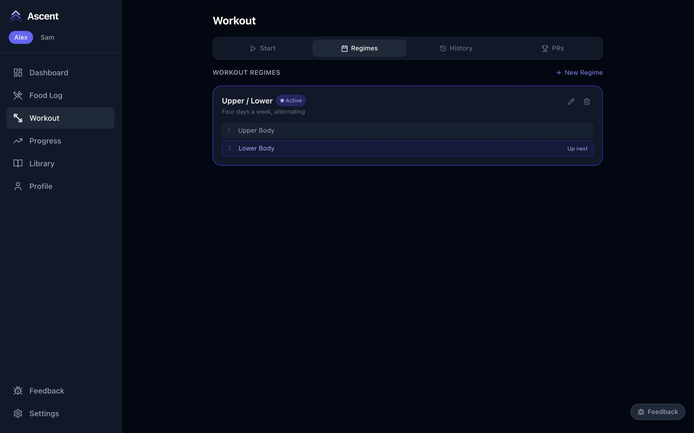

# 5. Regimes

[← Exercises and routines](04-exercises-and-routines.md) · Next: [Training →](06-training.md)

A regime is a rotation of routines — Upper / Lower, Push / Pull / Legs, and so on. With one active, Ascent keeps track of which routine is **up next**, so you never have to remember where you left off.

## Create a regime

1. Go to **Workout → Regimes** and press **New Regime**.
2. Give it a **name** and, if you like, a note about what it's for.
3. Under **Days**, pick the routine for each day in order. **Add Day** adds another; a routine can appear more than once (e.g. Upper, Lower, Upper, Lower).
4. Press **Save Regime**.

## Make it active

Press **Set as active** on the regime. It's marked **Active**, and the routine that comes next in the rotation is labelled **Up next**.

The rotation follows the order, not the calendar: miss a day and the same routine is still waiting. Use the pencil to change a regime and the bin to delete it. Each person has their own regimes.
