# 6. Training

[← Regimes](05-regimes.md) · Next: [History and progress →](07-history-and-progress.md)

Every session follows the same loop:

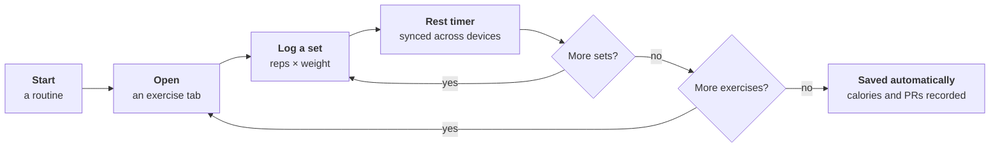

## Start a workout

Open **Workout**. The **Start** tab lists your routines with when you last did each one. Press **Start** on a routine, or choose:

- **Ad-hoc (no routine)** to build the session as you go, or
- **Log Activity** to record a walk, run, class or anything else without set-by-set tracking.

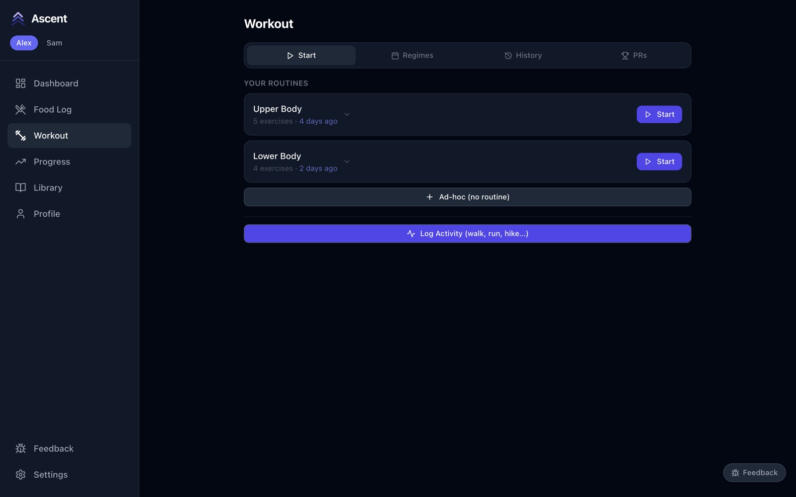

## The live workout screen

The routine opens on its first exercise.

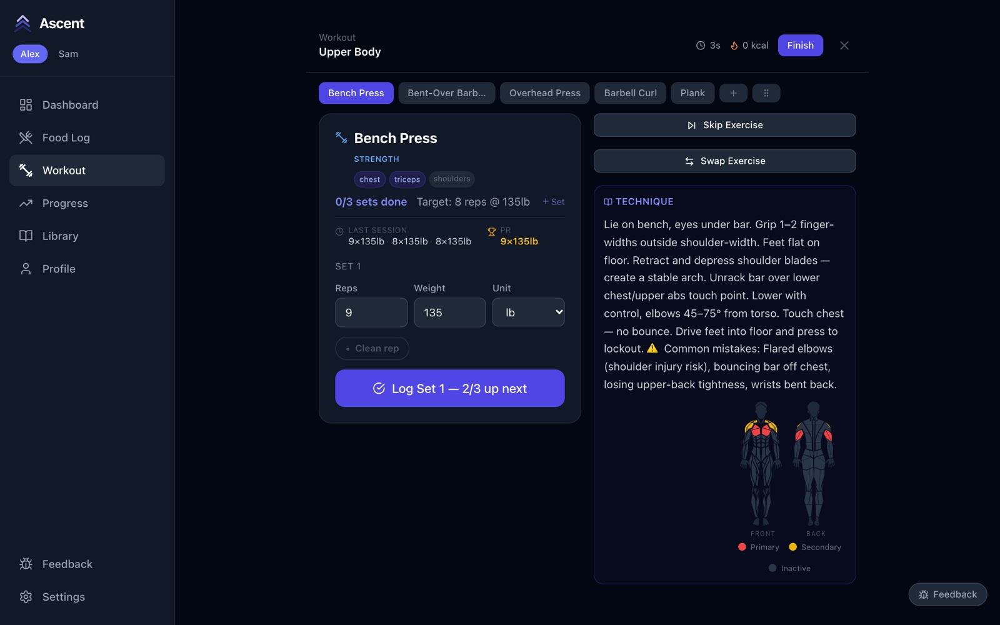

- **Header** — time so far, estimated calories, **Finish**, and **✕** to abandon.
- **Exercise tabs** — tap to jump between exercises. Done ones turn green with a ✓; **+** adds an exercise and **⋮⋮** reorders them.
- **Card** — sets done and the target, what you did **last session**, and your **PR**: the heaviest weight you've lifted for at least 4 reps, and the most reps at that weight.
- **Technique** — how to do the move, and which muscles it works.

## Log a set

1. Check the **reps** and **weight** (pre-filled from your target) and change them to what you actually did.
2. Press **Log Set**. On the last set the button reads **Log Final Set**.
3. If the set beats your record it's flagged **PR!** straight away; matching it shows **= PR**.
4. The **rest timer** starts on its own and counts down to the rest you set in the routine. It keeps time on every device showing this workout.

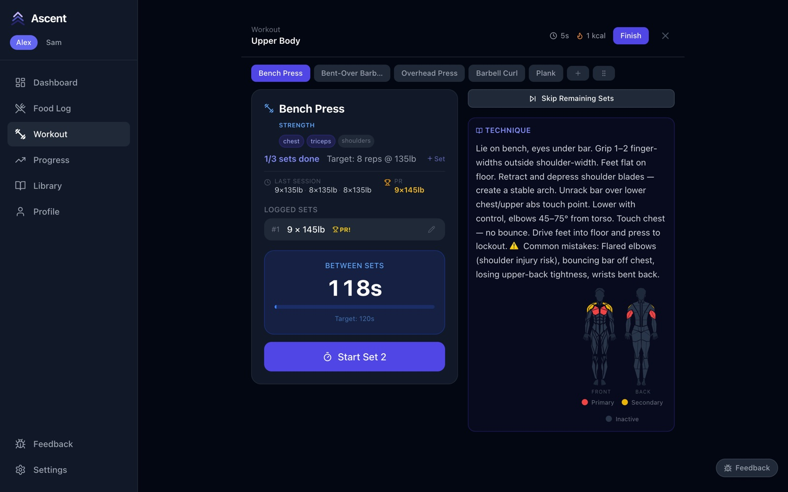

5. When you're ready, press **Start Set 2** (you don't have to wait for the timer) and repeat.

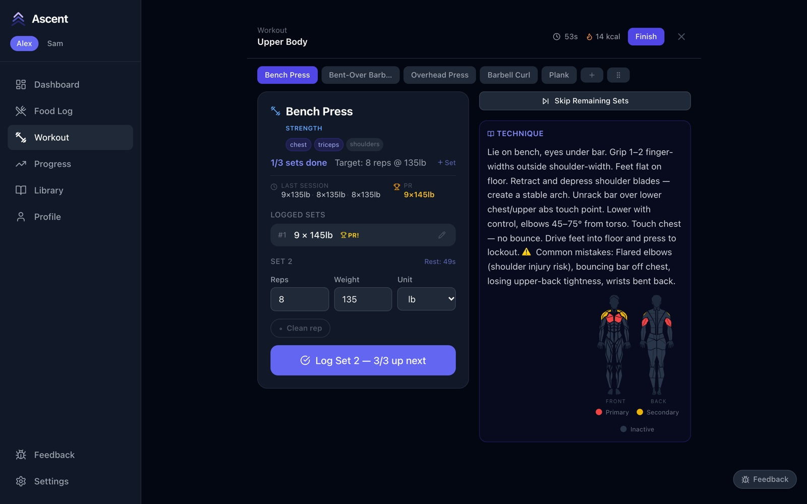

**Clean rep** under the inputs marks a set as **Assisted** (a spot, a cheat rep). Assisted sets show an orange **A** in your history.

## Fix a mistake

Tap the **pencil** on a logged set to change its reps, weight or unit, toggle clean/assisted, then **✓** to save or **✕** to cancel. The **bin** deletes the set.

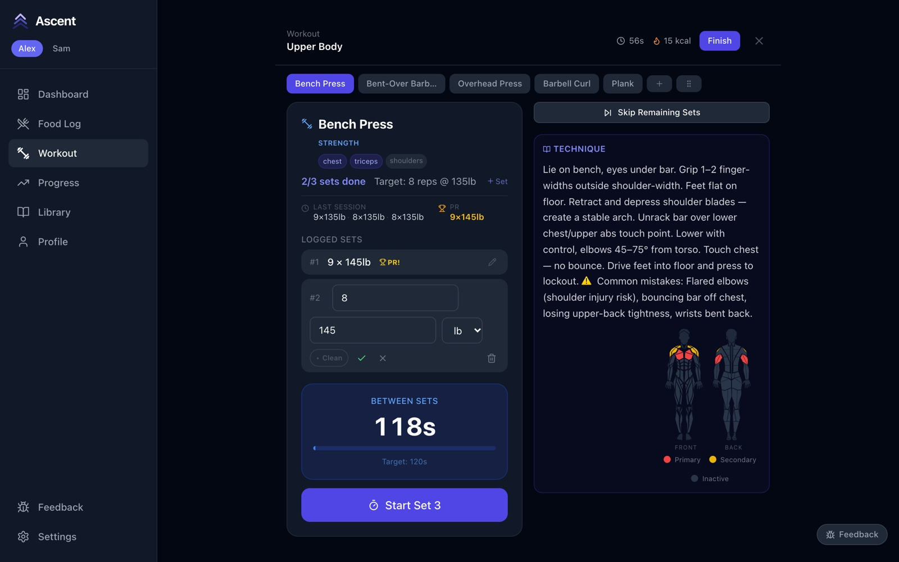

## Change the plan mid-workout

- **Swap Exercise** — replace an exercise you haven't started (machine taken, something hurts). The targets carry over.

  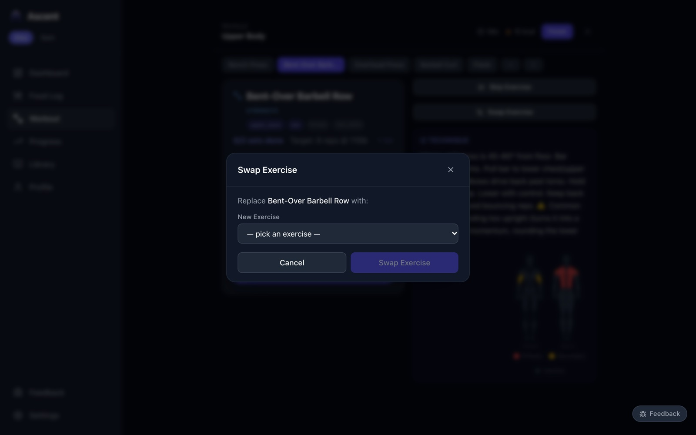

- **Skip Exercise** / **Skip Remaining Sets** — move on without finishing. A skipped exercise shows **Undo Skip** if you change your mind, and **Add Extra Set** lets you do more on any finished exercise. **+ Set** next to the target adds a set before you finish.

  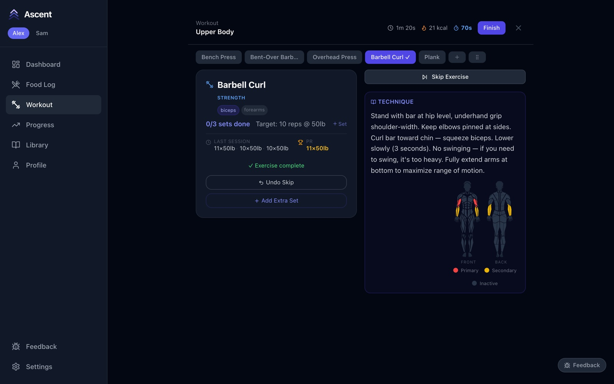

## Timed exercises

For holds like a plank, press **Start Timer**. It counts up against your target; press **Stop Timer**, adjust the **duration** if needed, and press **Log Set**.

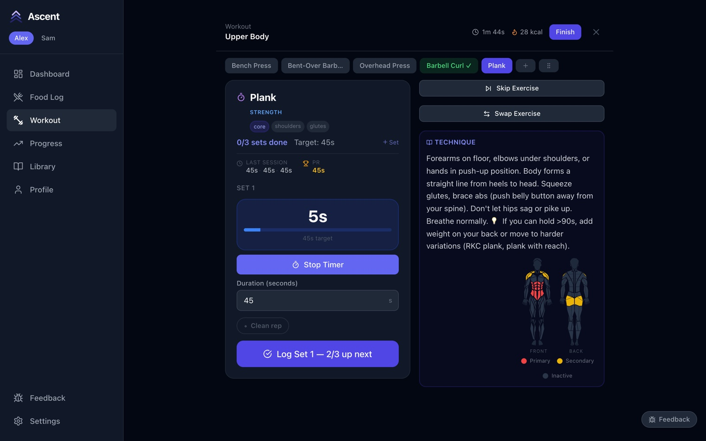

## Finish

The workout saves itself as soon as every exercise is done or skipped. To end early, press **Finish**; Ascent tells you how many exercises are still pending. Press **Finish & Save**.

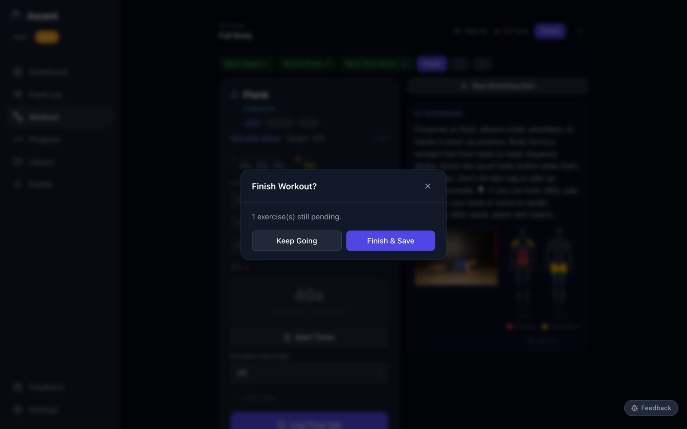

The summary shows duration, exercises, sets, total volume and estimated calories. If a watch or fitness tracker measured the calories, type its figure over the estimate. Press **Done**.

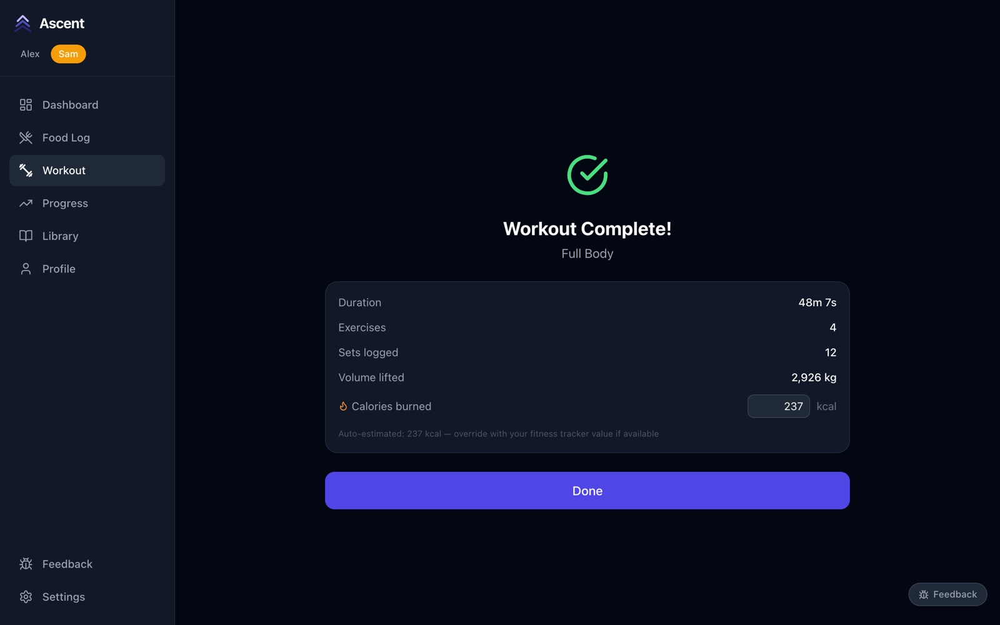

To throw a session away instead, press **✕** and confirm **Abandon**. Abandoned sessions stay in your history, marked as such, until you delete them.

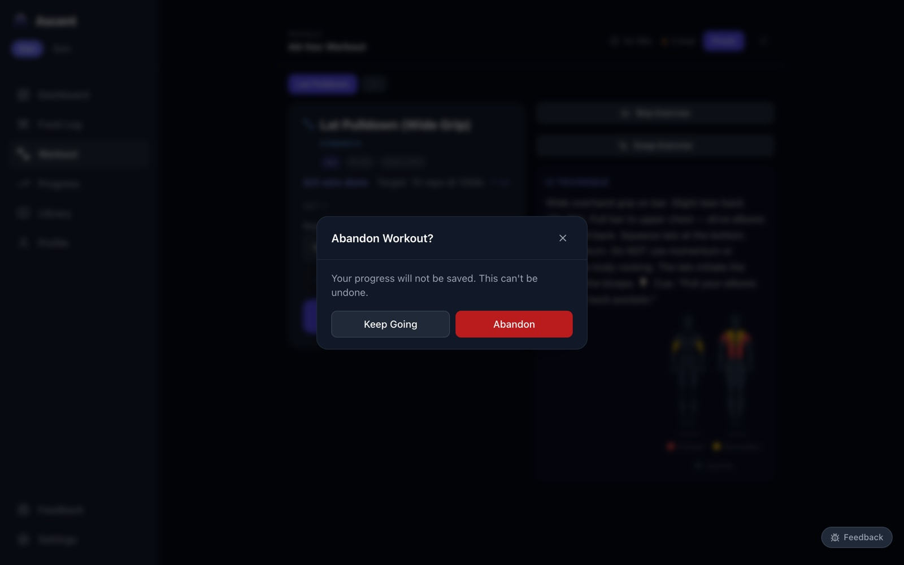

## Ad-hoc workouts

**Ad-hoc (no routine)** starts an empty session. Press **Add Exercise**, choose the exercise, set the sets, reps and weight, and press **Add**. From there it works like any other workout.

| Empty session | Adding an exercise |
|---|---|
| 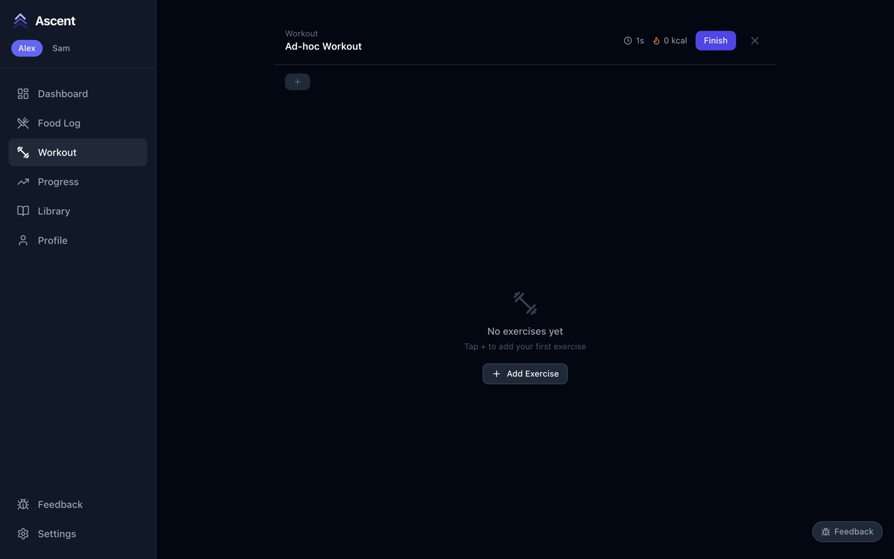 | 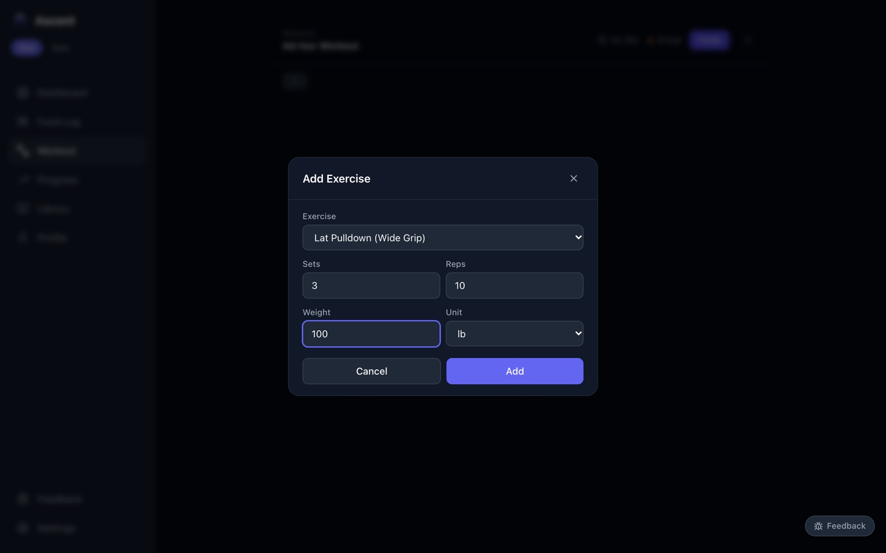 |

## Log an activity

**Log Activity** records something you did without the app — a walk, a run, a class. Pick a type (or type your own), the date, the duration, and the **calories burned** from your watch or a rough estimate. It counts toward that day's calorie target.

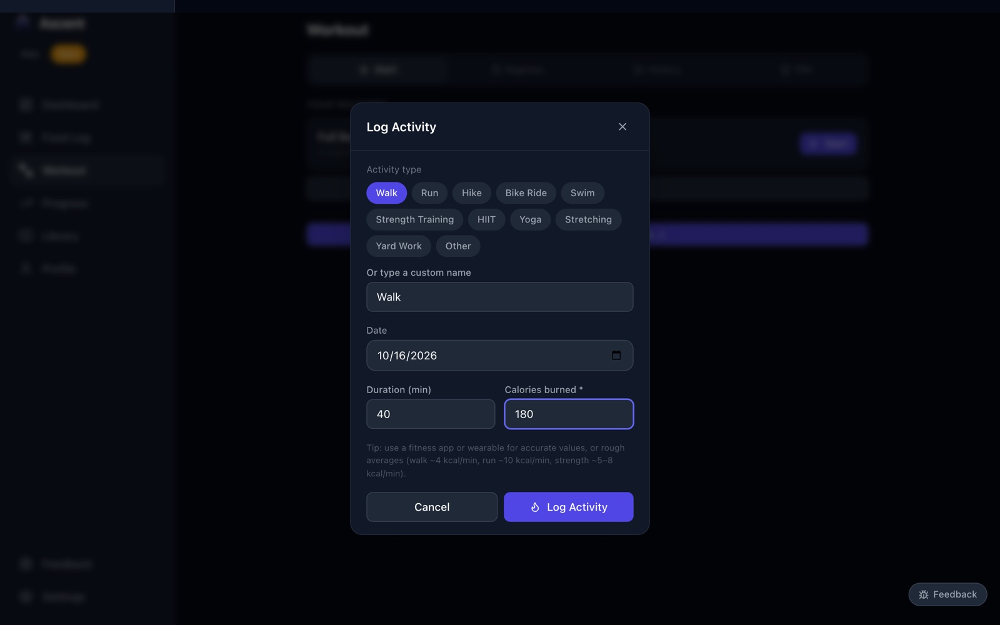

## Training together

If you both have a workout in progress, the dashboard offers **Resume Together**, which shows both live workouts side by side on one screen — see [Dashboard and household](01-dashboard.md#training-together).
