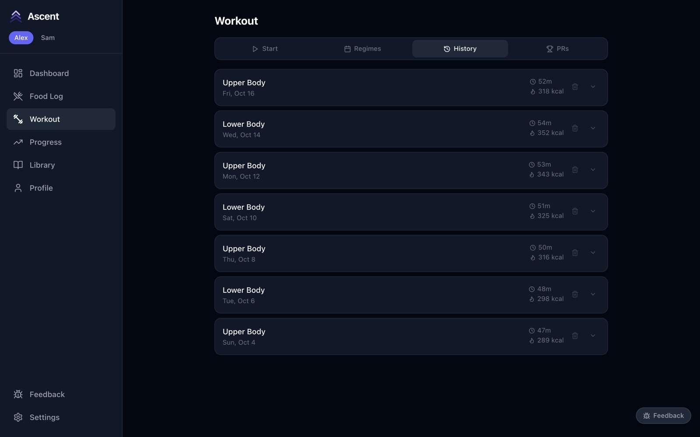
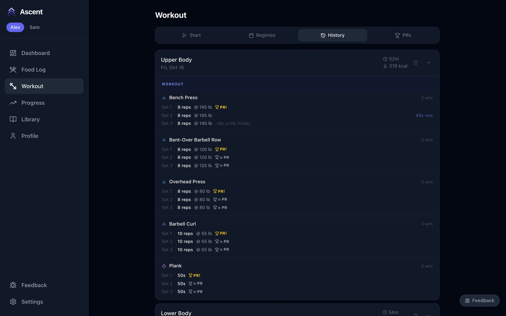
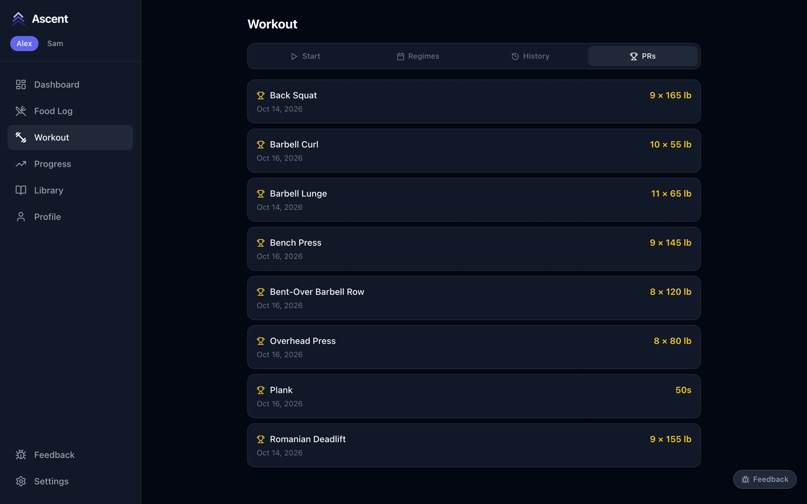
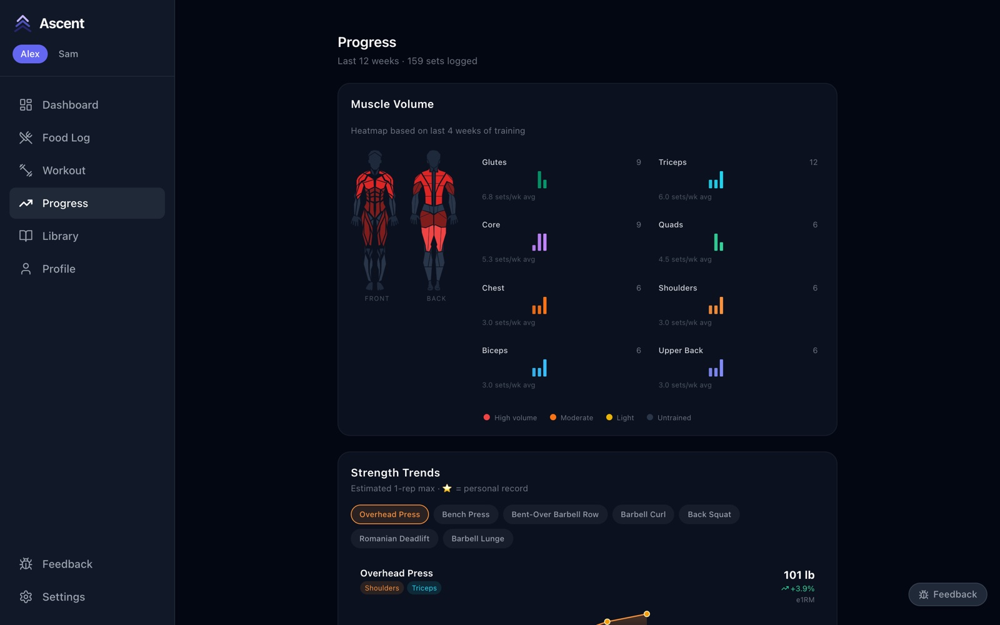
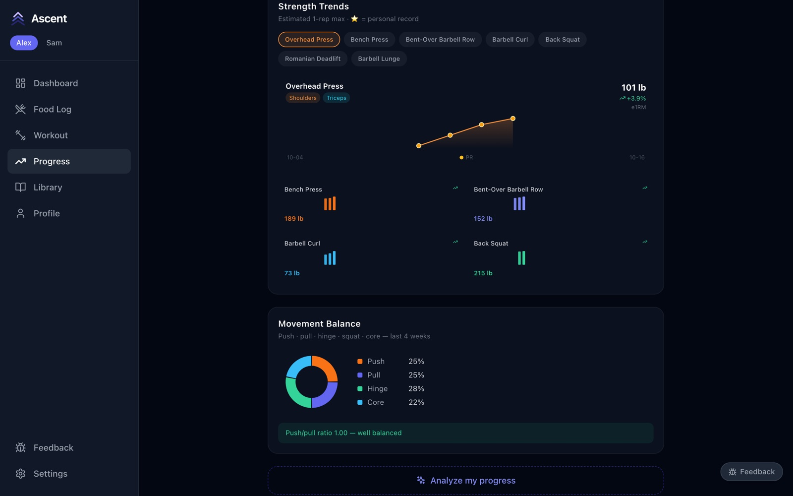
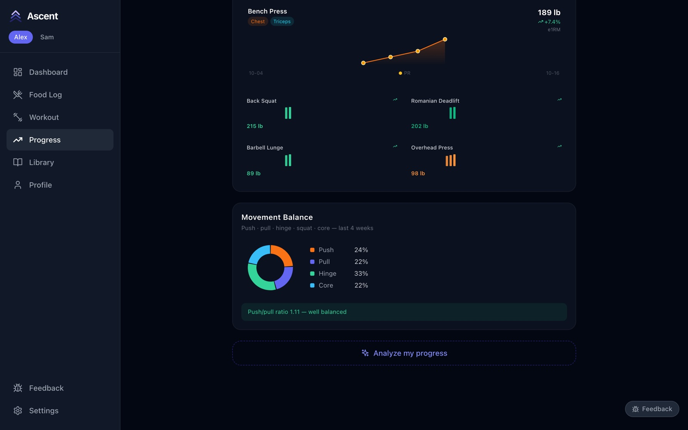

# 7. History and progress

[← Training](06-training.md) · Next: [Profile, settings and feedback →](08-profile-settings-feedback.md)

## Workout history

**Workout → History** lists every session with its date, duration and calories. Tap one to see each exercise, every set, PRs and the rest you took. The bin deletes a session.

## Personal records

**Workout → PRs** lists your current record for every exercise and the date you set it: reps × weight for weighted lifts, reps for bodyweight moves, seconds for timed ones.

## The Progress page

**Progress** covers the last 12 weeks.

**Muscle Volume** shows how many sets each muscle group got per week over the last four weeks. The body map shades heavily trained muscles red and untrained ones grey — a quick way to spot what you're skipping.

**Strength Trends** plots your estimated one-rep max for each lift over time; tap a lift to chart it, and a dot marks each PR. **Movement Balance** splits your training into push, pull, hinge, squat and core, and says whether push and pull are balanced.

**Analyze my progress** at the bottom writes a short AI summary of your recent training and nutrition. Like the food parser, it needs an Anthropic API key (see [Getting started → AI features](../getting-started.md#ai-features)).

