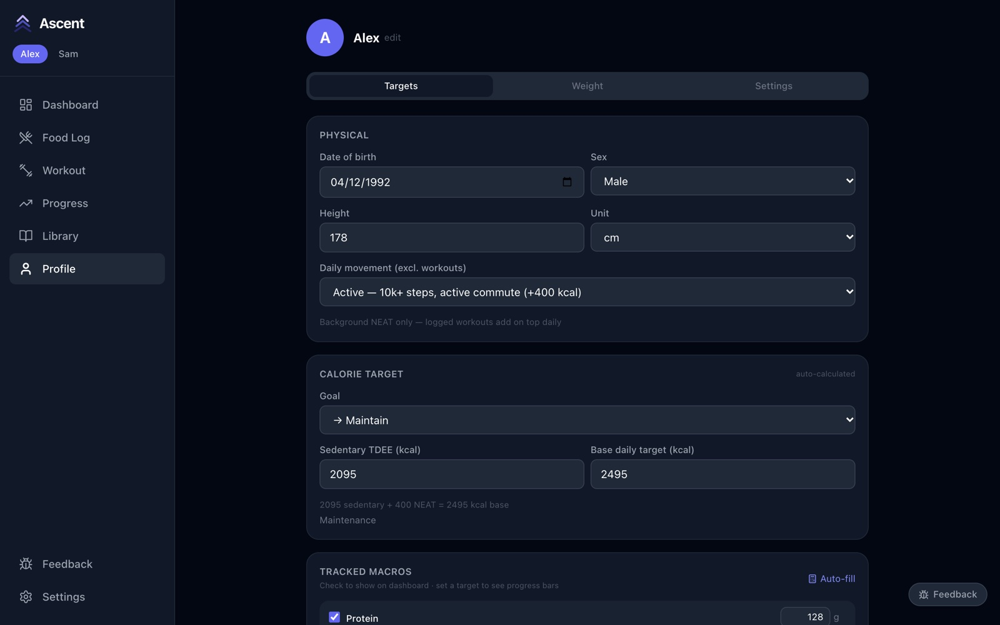
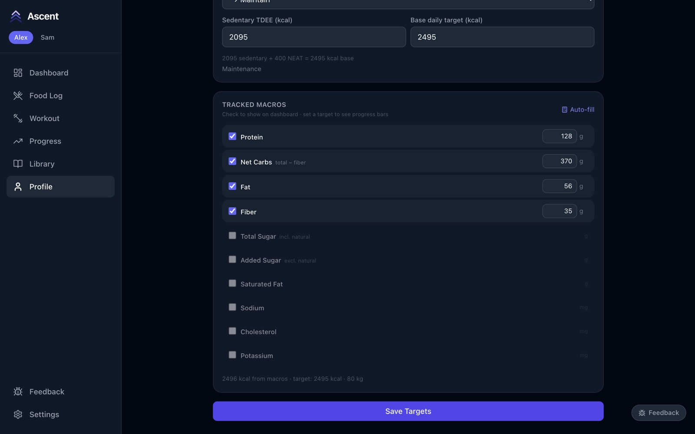
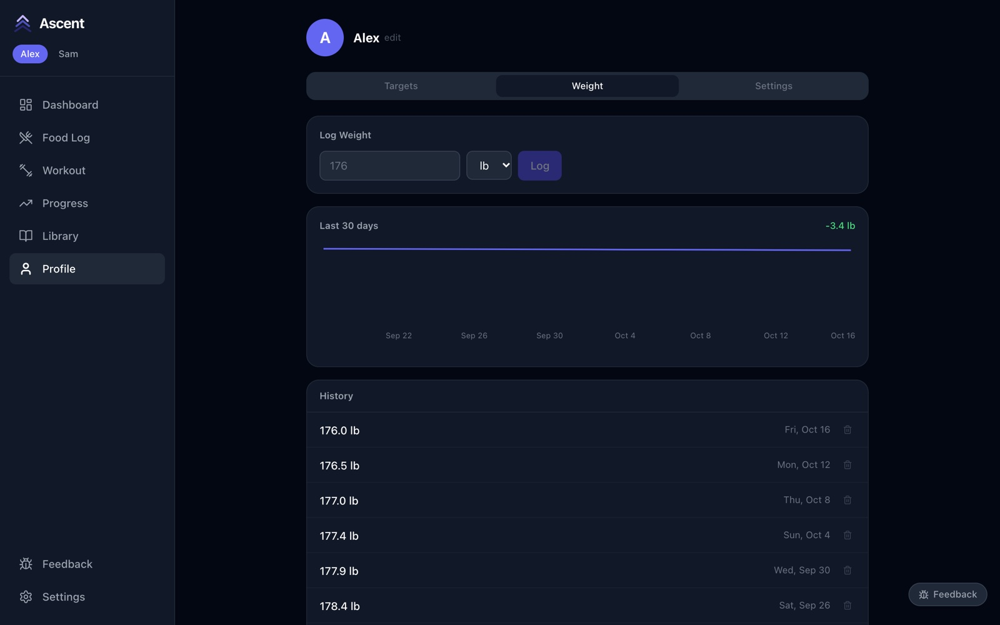
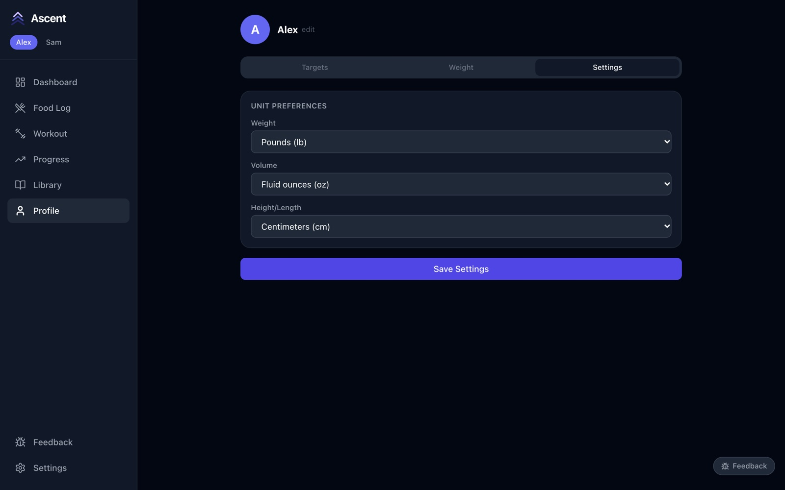
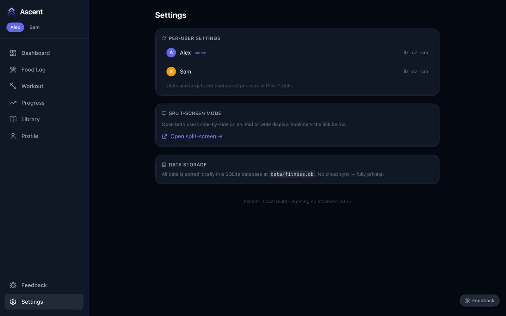
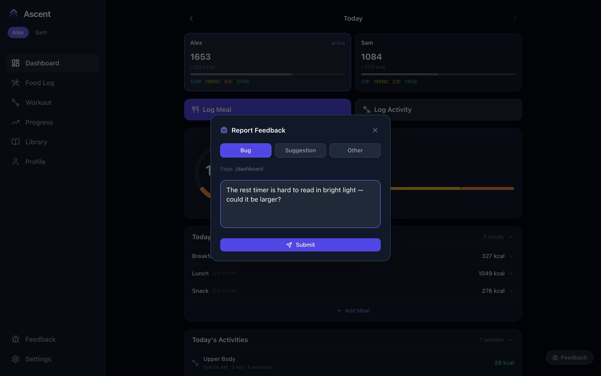
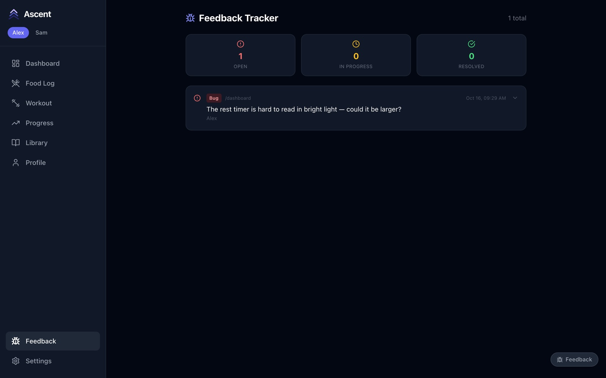

# 8. Profile, settings and feedback

[← History and progress](07-history-and-progress.md) · Next: [Offline use and sync →](09-offline-and-sync.md)

## Targets

**Profile → Targets** holds the numbers your calorie target is worked out from. It starts with what you entered when you set up the app, and recalculates as you change anything.

- **Physical** — date of birth, sex and height.
- **Daily movement** — your activity *outside* workouts (steps, commute, an active job). Logged workouts are added on top each day, so don't count them here.
- **Goal** — maintain, or lose or gain at a mild or full pace.
- **Base daily target** — what you eat on a rest day. The line underneath shows how it was worked out.

Further down, **Tracked macros** chooses which nutrients appear on the dashboard and food log, with a daily target for each. **Auto-fill** suggests targets from your calories and weight. Press **Save Targets** when you're done.

To rename yourself, tap **edit** next to your name at the top.

## Weight

**Profile → Weight** is where you log your body weight. The chart shows the last 30 days and the change over that time; the list below shows every entry, with a bin to remove mistakes. Your latest weight is used to estimate calories burned in workouts, so update it every week or two.

## Units

**Profile → Settings** sets the units you see: pounds or kilograms, fluid ounces or millilitres, centimetres or feet. Each person chooses their own. Press **Save Settings**.

## App settings

**Settings** (bottom of the sidebar, or the gear on a phone) lists everyone in the household with their units — tap a person to open their profile — links to split-screen mode, and reminds you where the data lives.

## Feedback

Spotted a bug or have an idea? Press **Feedback** in the bottom-right corner of any page (on a phone it's a small bug icon), choose **Bug**, **Suggestion** or **Other**, describe it and press **Submit**. Ascent records which page you were on.

Everything reported appears on the **Feedback** page, with counts of what's open, in progress and resolved. Expand an item to change its status or add notes. Feedback stays in your own database; nothing is sent anywhere.

