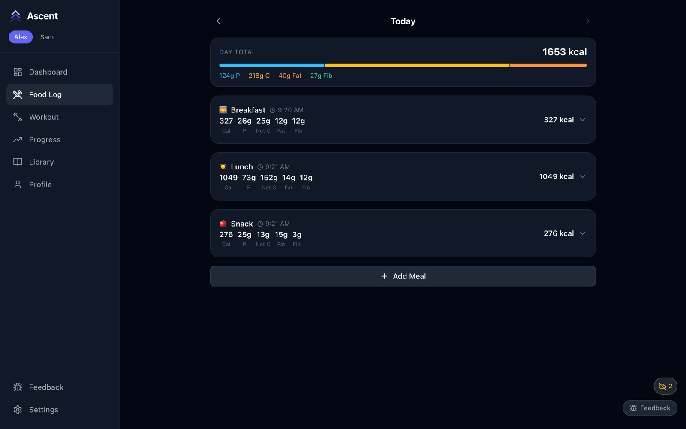
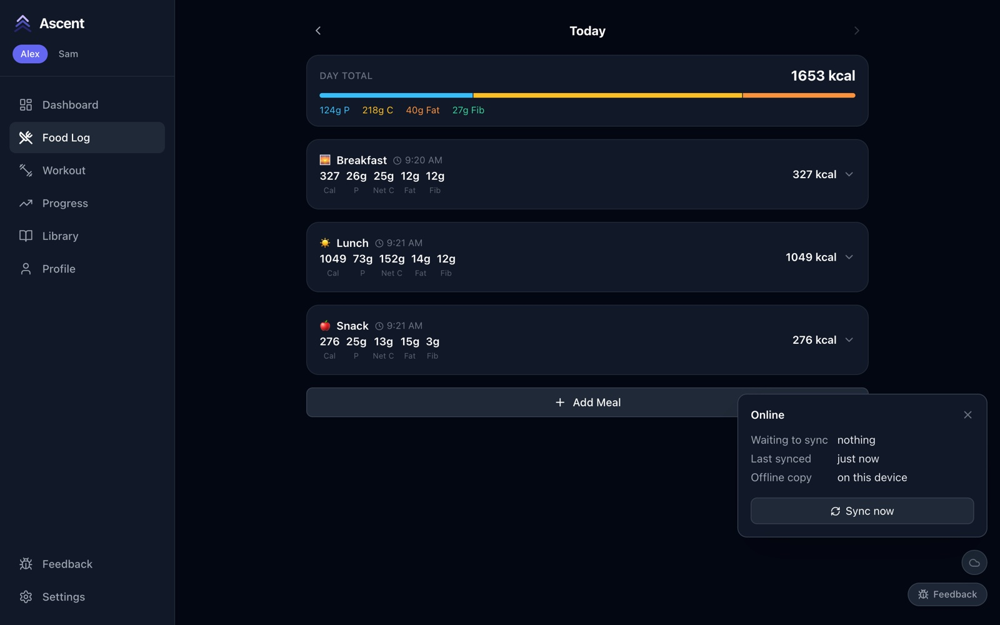

# 9. Offline use and sync

[← Profile, settings and feedback](08-profile-settings-feedback.md) · [Back to the user guide](../guide.md)

Every phone, tablet or browser that opens Ascent keeps its own copy of your data. When the laptop running Ascent can't be reached — you're at the gym, the laptop is asleep, the Wi-Fi drops — everything keeps working, and your changes are sent to the laptop as soon as it's reachable again.

## What works offline

Everything except the two AI features: logging meals and workouts, the rest timer, PRs, editing routines and regimes, the library, history, progress charts and your profile. Offline screens are worked out by the same code as online, so the numbers match.

The device needs to reach the server once first, to download its copy. After you update Ascent on the laptop, each device needs one sync while connected before it works offline again.

## Knowing where you stand

A small round icon sits above the Feedback button:

| Icon | Meaning |
|---|---|
| Grey cloud | Online and up to date |
| Amber cloud with a line through it, plus a number | Offline; that many changes are waiting on this device |
| Blue cloud with an arrow | Sending changes to the server |
| Red warning | Something needs your attention — open the panel |

Tap the icon for details: how many changes are waiting, when the device last synced, and a **Sync now** button.

Once the server is reachable, the changes go out on their own (or press **Sync now**), and the panel shows nothing waiting:

## When two devices change the same thing

- **Adding things never conflicts.** If you and your partner both log meals or sets while offline, everything is kept. Set numbers and PRs are recalculated once it all reaches the server.
- **Editing the same value on two devices:** the edit made later wins. Edits to different details of the same entry are both kept.
- **Deleting wins.** If one device deletes something another device edited or added to, the delete stands.

Anything that couldn't be applied is listed in the sync panel, so nothing disappears silently. "Later" is judged by each device's clock, so keep the date and time on your phone set automatically.

## Using a browser instead of the app

In a phone's browser, an open Ascent tab keeps working offline. But if you **reload** it while offline it won't open, because browsers only let web apps start offline from `localhost` or a secure (https) address. The [Android app](../android.md) doesn't have this limit.

## Photos

Photos you add offline are kept on the device and uploaded when it syncs. Photos already on the server show offline only if you've viewed them before on that device.
